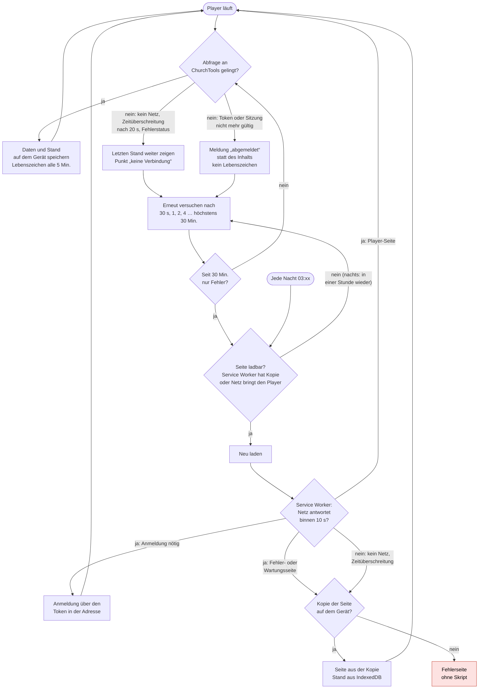

# Der Fernseher, wenn ChurchTools ausfällt

Was der Player tut, wenn die ChurchTools-Instanz nicht erreichbar ist – etwa bei einer Wartung, einem
Netzausfall oder wenn ChurchTools die Systeme vorsorglich herunterfährt. Stand `v0.48.1`, abgelesen aus
`src/player/controller.ts`, `src/player/timing.ts`, `src/sw/sw.ts` und `src/views/PlayerView.vue`.

## Kurz gesagt

- **Der Fernseher zeigt weiter seinen letzten Stand**, mit einem kleinen Punkt in der Ecke („keine
  Verbindung“). Bilder, Videos und eigene Schriften liegen auf dem Gerät.
- **Er fragt immer seltener nach**: erst nach 30 Sekunden, dann doppelt so lange, höchstens alle 30 Minuten.
- **Das Lebenszeichen fällt aus**: Im Designer steht der Screen nach 15 Minuten als „nicht online“.
- **Neu geladen wird nur, wenn danach wieder der Player läuft** – nach 30 Minuten nur Fehlern und jede Nacht
  gegen 3 Uhr. Kommt beim Neuladen statt des Players eine Fehler- oder Wartungsseite, zeigt der Service Worker
  die Kopie auf dem Gerät. Ist ChurchTools wieder da, erholt sich der Fernseher von selbst.

## Ablauf

Der rote Kasten ist eine Sackgasse: Auf einer Seite ohne unser Skript versucht niemand mehr etwas. Heraus
führen nur ein Neuladen von Hand oder ein Neustart des Kiosk-Browsers. Er ist nur noch erreichbar, wenn das
Gerät keine Kopie hat (unten, 2).

## Was offen bleibt

1. **Ungültige Anmeldung.** Setzt ChurchTools nach einem Sicherheitsvorfall Sitzungen oder Login-Token zurück,
   zeigt der Fernseher „abgemeldet“ und meldet kein Lebenszeichen mehr. Das kann das Modul nicht selbst lösen –
   ein neuer Token gehört in die Kiosk-Adresse –, es ist aber am Fernseher sichtbar.
2. **Ohne Kopie.** Ein Gerät, das noch nie erfolgreich gezeigt hat, oder ein Browser ohne Service Worker hat
   keine Kopie. Ohne Kopie lädt der Player nur neu, wenn das Netz die Player-Seite selbst bringt – eine
   Wartungsseite mit `200` zählt nicht. Die Kopie kann auch verschwinden: Wird der Speicher knapp, darf der
   Browser alles räumen, was die Seite abgelegt hat. Deshalb bittet der Player nach dem ersten erfolgreichen
   Anzeigen darum, seinen Speicher zu behalten (`navigator.storage.persist()`). Chromium entscheidet darüber
   selbst, ohne zu fragen; lehnt es ab, steht das nur in der Konsole.
3. **Eine Weiterleitung auf eine Wartungsseite.** Weiterleitungen reicht der Service Worker unverändert durch,
   weil die Anmeldung über den Token eine ist. Leitet ChurchTools während eines Ausfalls auf eine eigene Adresse
   um, landet der Fernseher dort. Wie ChurchTools einen Ausfall ausliefert, ist nicht gemessen.

## Der Ausfall vom 21.10.2026

ChurchTools hat die Systeme am Nachmittag des 21.10. wegen einer PHP-Lücke kurzzeitig heruntergefahren. Beide
Screens meldeten sich zuletzt um 15:52 und 15:54 und danach nicht mehr – auch nicht, als ChurchTools wieder lief.
Im ChurchTools-Protokoll (Log Viewer, Person des Geräte-Benutzers) fehlen seither die täglichen Anmeldungen
„mittels logintoken“, die jeder Fernseher alle 24 Stunden beim Ablauf seiner Sitzung schreibt; das nächtliche
Neuladen schreibt keine. Bis `v0.48.0` gab der Service Worker eine Fehler- oder Wartungsseite beim Neuladen
unverändert weiter, und das nächtliche Neuladen prüfte nichts – auf so einer Seite blieben die Fernseher stehen,
bis jemand sie neu startete. `v0.48.1` schließt diese Lücke.

**Woran man einen hängenden Fernseher erkennt:** im Designer „nicht online“, und im Protokoll seit mehr als
24 Stunden keine Anmeldung des Geräte-Benutzers.
