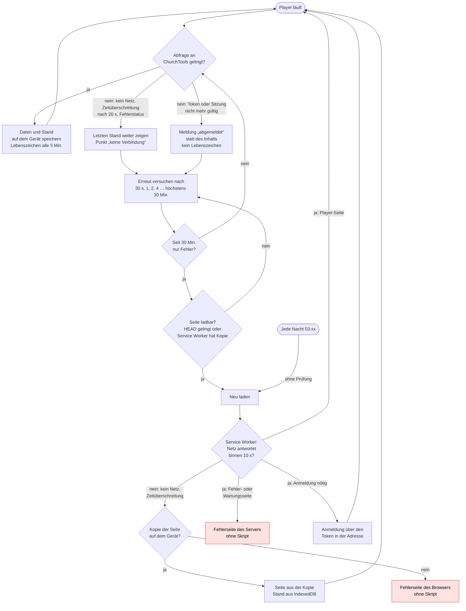

# Der Fernseher, wenn ChurchTools ausfällt

Was der Player tut, wenn die ChurchTools-Instanz nicht erreichbar ist – etwa bei einer Wartung, einem
Netzausfall oder wenn ChurchTools die Systeme vorsorglich herunterfährt. Stand `v0.48.0`, abgelesen am
2026-10-22 aus `src/player/controller.ts`, `src/player/timing.ts`, `src/sw/sw.ts` und
`src/views/PlayerView.vue`.

## Kurz gesagt

- **Solange die Seite offen bleibt, zeigt der Fernseher weiter seinen letzten Stand**, mit einem kleinen
  Punkt in der Ecke („keine Verbindung“). Bilder, Videos und eigene Schriften liegen auf dem Gerät.
- **Er fragt immer seltener nach**: erst nach 30 Sekunden, dann doppelt so lange, höchstens alle 30 Minuten.
- **Das Lebenszeichen fällt aus**: Im Designer steht der Screen nach 15 Minuten als „nicht online“.
- **Kritisch ist jedes Neuladen** – nach 30 Minuten nur Fehlern und jede Nacht gegen 3 Uhr. Ist die Instanz
  ganz weg, holt der Service Worker die Seite von der Kopie auf dem Gerät. **Antwortet der Server aber mit
  einer Fehlerseite**, zeigt der Fernseher diese Fehlerseite – und bleibt dort, bis jemand neu lädt oder der
  Kiosk neu startet (Lücke 1 unten).

## Ablauf

Rote Kästen sind Sackgassen: Auf einer Seite ohne unser Skript versucht niemand mehr etwas. Heraus führen nur
ein Neuladen von Hand oder ein Neustart des Kiosk-Browsers.

## Lücken

1. **Fehlerseite statt Kopie.** Der Service Worker lädt die Seite „Netz zuerst“ und greift nur dann zur Kopie,
   wenn die Anfrage scheitert oder länger als 10 Sekunden dauert (`handlePlayerNavigation` in `src/sw/sw.ts`).
   Läuft der Webserver noch und antwortet mit `502`, `503` oder einer Wartungsseite, reicht er diese Antwort
   unverändert durch. Genau das ist der wahrscheinliche Fall bei einer geplanten Abschaltung.
2. **Die Prüfung vor dem Neuladen passt nicht dazu.** `canReload()` fragt zuerst `HEAD` auf die Seite; scheitert
   das, genügt die Antwort des Service Workers „Kopie vorhanden“. Die Kopie wird beim Neuladen dann aber gar
   nicht genommen, wenn der Server antwortet (Lücke 1). Antwortet eine Wartungsseite mit `200`, gilt die Seite
   sogar als ladbar.
3. **Das nächtliche Neuladen prüft gar nichts** (`later(msUntilNightlyReload(…), deps.reload)`). Fällt ein
   Ausfall in die Zeit um 3 Uhr, landet der Fernseher bei Lücke 1 auf der Fehlerseite.
4. **Ungültige Anmeldung.** Setzt ChurchTools nach einem Sicherheitsvorfall Sitzungen oder Login-Token zurück,
   zeigt der Fernseher „abgemeldet“ und meldet kein Lebenszeichen mehr. Das kann das Modul nicht selbst lösen –
   ein neuer Token gehört in die Kiosk-Adresse –, es ist aber wenigstens am Fernseher sichtbar.
5. **Erster Start ohne Netz.** Ein Gerät, das noch nie erfolgreich gezeigt hat, hat keine Kopie. Das ist
   bekannt und bleibt so.

## Absicherung

- **Service Worker: bei Serverfehlern die Kopie zeigen.** Antwortet das Netz mit einem Status ab `500` und liegt
  eine Kopie vor, die Kopie ausliefern statt der Fehlerseite. Dazu eine reine Entscheidungsfunktion in
  `src/sw/logic.ts`, unit-getestet wie die übrigen. Anmeldeseite und Weiterleitungen (Antwort `200` oder `3xx`)
  bleiben unberührt, damit die Anmeldung über den Token weiter trägt.
- **Ein Neuladen nur, wenn danach der Player läuft.** `canReload()` verlangt von `HEAD` eine Antwort `200`
  mit HTML; sonst zählt die Kopie – die nach dem ersten Punkt dann auch wirklich gezeigt wird. Das nächtliche
  Neuladen geht durch dieselbe Prüfung und verschiebt sich sonst um eine Stunde.
- **Ein Test für den Ausfall.** Im e2e-Test die Seite und `/api/` mit `503` beantworten lassen und prüfen, dass
  nach einem Neuladen wieder der letzte Stand mit dem Punkt „keine Verbindung“ erscheint.
- **Außerhalb des Moduls:** Ein Kiosk-Startskript, das den Browser in einer Schleife neu startet, fängt einen
  Absturz ab, nicht aber eine angezeigte Fehlerseite. Die ersten beiden Punkte sind deshalb nicht ersetzbar.
