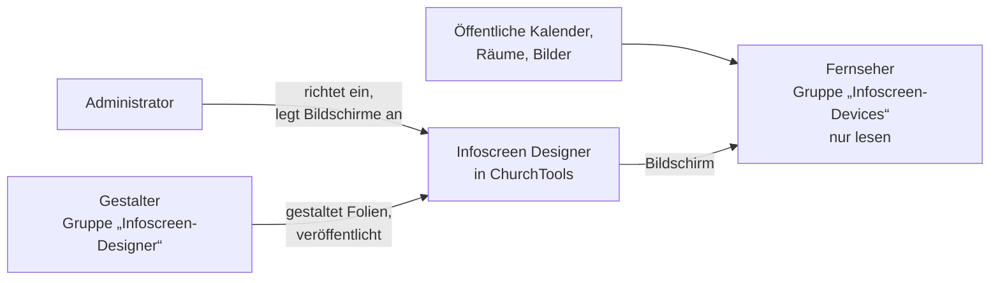

# Infoscreen Designer einrichten

Diese Anleitung führt dich als **ChurchTools-Administrator** durch die Einrichtung: von der Installation bis zum
Fernseher im Foyer. Rechne mit etwa einer halben Stunde, den Fernseher nicht mitgezählt. Die Kurzfassung je Rolle
steht im [Onboarding](Onboarding.md), alle Rechte als Tabelle in der [Rechte-Übersicht](Rechte.md).

> **Kein Produkt der ChurchTools Innovation GmbH.** Der Infoscreen Designer ist eine unabhängige Entwicklung von
> Anwendern. Fragen gehören in den [Issue-Tracker](https://github.com/wirsindcgks/churchtools-infoscreen/issues),
> nicht an den ChurchTools-Support.

## Auf einen Blick

| Schritt | Wo |
| --- | --- |
| [1. Extension installieren](#1-extension-installieren) | Extension-Verwaltung von ChurchTools |
| [2. Dir selbst die Modulrechte geben](#2-dir-selbst-die-modulrechte-geben) | Rechteverwaltung |
| [3. Den Designer einmal öffnen](#3-den-designer-einmal-öffnen) | Menü „Infoscreen Designer" |
| [4. Gruppen und Rechte anlegen lassen](#4-gruppen-und-rechte-anlegen-lassen) | Designer → Einstellungen |
| [5. Gestalter aufnehmen](#5-gestalter-aufnehmen) | Gruppe „Infoscreen-Designer" |
| [6. Geräte-Benutzer anlegen](#6-geräte-benutzer-anlegen) | Personen, Gruppe „Infoscreen-Devices" |
| [7. Den Fernseher einrichten](#7-den-fernseher-einrichten) | Designer → Einstellungen, dann am Gerät |

**Drei Rollen:** Der **Administrator** richtet ein und legt die Bildschirme an. **Gestalter** (Gruppe
„Infoscreen-Designer") gestalten, was die Bildschirme zeigen. Das **Gerät** (Gruppe „Infoscreen-Devices") zeigt
einen Bildschirm an und darf nur lesen.

### Voraussetzungen

- **Extensions müssen für eure Instanz freigeschaltet sein.** Gibt es die Extension-Verwaltung aus Schritt 1 nicht,
  bei ChurchTools anfragen.
- **Ein Administrator-Konto**, das Berechtigungen und Gruppen verwalten darf. Fehlt dir ein Recht, nennt es die
  Einstellungsseite ([Einzelheiten](Rechte.md#churchtools-selbst--nur-für-administratoren)).
- **Pro Fernseher ein Gerät mit Browser**, das im Vollbild dauerhaft eine Webseite zeigt – etwa ein Raspberry Pi,
  ein Mini-PC oder ein Smart-TV mit Kiosk-Browser.

---

## 1. Extension installieren

1. Das neueste `churchtools-infoscreen-vX.Y.Z.zip` von der
   [Release-Seite](https://github.com/wirsindcgks/churchtools-infoscreen/releases) herunterladen. **Nicht entpacken.**
2. In ChurchTools die Extension-Verwaltung öffnen: `https://<eure-instanz>.church.tools/custom/modules/overview`.
3. **„Erweiterung hinzufügen"** und ausfüllen:

   | Feld | Eintrag |
   | --- | --- |
   | Name | `Infoscreen Designer` |
   | Kürzel | **exakt** `infoscreen-designer` – mit Bindestrich, alles klein |
   | Beschreibung | frei, etwa `Gestaltung und Ausspielung der Infoscreens` (Pflichtfeld) |
   | Im Menü anzeigen | Haken lassen |
   | ZIP-Datei | das heruntergeladene ZIP |

   **Das Kürzel muss stimmen** – sonst öffnet der Menüpunkt nur eine weiße Seite.

Danach ist die Extension installiert, aber **noch für niemanden sichtbar, auch nicht für dich**. Das ist richtig so:
Administratorrechte schließen die Rechte an einer Extension nicht ein.

## 2. Dir selbst die Modulrechte geben

Am besten über die Rolle einer Gruppe, in der die Administratoren ohnehin sind
([Academy: globale Berechtigung vergeben](https://churchtools.academy/de/help/rechteverwaltung/berechtigungen-vergeben/wie-vergebe-ich-eine-globale-berechtigung/)):

1. **Rechteverwaltung** → Reiter **Gruppen** → eure Administratoren-Gruppe.
2. Bei deiner Rolle auf **Bearbeiten**.
3. **„Infoscreen Designer"** aufklappen und so einstellen:

   | Berechtigung | Einstellung |
   | --- | --- |
   | „Infoscreen Designer" sehen | ✓ |
   | Kategorien sehen | ✓, „alle" |
   | Kategorien erstellen | ✓ |
   | Kategorien bearbeiten, Kategorien löschen | kein Haken |
   | Daten in Kategorie sehen, erstellen, bearbeiten, löschen | ✓, „alle" |

4. **Speichern.** Die Gruppe muss den Status **„aktiv"** haben.

## 3. Den Designer einmal öffnen

Oben im Menü steht jetzt **„Infoscreen Designer"** (sonst die Seite neu laden). Beim ersten Öffnen legt der Designer
seine Datenablage in ChurchTools an.

## 4. Gruppen und Rechte anlegen lassen

Ein Assistent im Designer legt die Gruppen für Gestalter, Geräte und den Baustein „Personen“ samt allen Rechten an:

1. **Einstellungen → Räume:** prüfen, welche Ressourcentypen als Raum gelten. Gibt es bei euch den Typ „Raum", ist
   er vorgewählt und nichts zu tun. Sonst die passenden Typen ankreuzen und **„Speichern"**.
2. **Einstellungen → Gruppen und Rechte**, Karte **„Automatisch einrichten"**.
3. Den **Gruppentyp** wählen – vorgewählt ist „Merkmal". Nimm einen Typ, der seinen Rollen selbst wenig Rechte gibt:
   Gestalter und Fernseher bekämen sie mit
   ([Academy: Gruppentypen](https://churchtools.academy/de/help/app/rund-ums-gruppenmodul/37-was-sind-gruppentypen-und-wofur-kann-ich-sie-benutzen/)).
4. **„Gruppen und Rechte anlegen"** klicken.

Es entstehen zwei Gruppen: **„Infoscreen-Designer"** für die Gestalter und **„Infoscreen-Devices"** für die
Fernseher. Eine dritte, **„Infoscreen-People"** für den Baustein „Personen“, legst du nur auf Wunsch an
([unten](#personen-auf-den-bildschirmen)). Dazu kommt der Wiki-Bereich **„Infoscreen"**, in dem die Bilder der Mediathek liegen. Was genau welche
Gruppe darf, steht unter „Was genau passiert" auf der Seite und in der [Rechte-Übersicht](Rechte.md).

**Bildschirme anlegen:** auf der Startseite des Designers **„+ Bildschirm erstellen"**, je Fernseher einer. Name und
Overscan änderst du später über **„…"** an der Kachel.

### Gut zu wissen

- **Fernseher zeigen nur öffentliche Kalender** – solche, die man in ChurchTools auch ohne Anmeldung sieht
  (Berechtigungen → Benutzer → „Öffentlicher Benutzer" → Kalender). Einen neuen öffentlichen Kalender kann ein
  Gestalter sofort benutzen.
- **Interne Kalender freigeben:** Unter **Einstellungen → Interne Kalender für Bildschirme** lassen sich einzelne
  nicht öffentliche Kalender für die Bildschirme freischalten. **Wer die Adresse eines Fernsehers kennt, kann einen
  freigegebenen Kalender ganz lesen** – gib nur frei, was im Foyer stehen darf. Intern markierte Termine zeigt der
  Fernseher nie.
- **„Rechte aktualisieren"** (Einstellungen → Gruppen und Rechte) brauchst du, wenn ein Bildschirm neue Räume zeigt,
  wenn du interne Kalender oder Raumtypen änderst und nach einem Update. Eine Vorschau zeigt vorher, was dazukommt
  und was wegfällt – der Knopf nimmt auch Rechte zurück, die kein Bildschirm mehr braucht. Entzogene Rechte wirken in
  ChurchTools noch bis zu einer Dreiviertelstunde nach ([Einzelheiten](Rechte.md#was-rechte-aktualisieren-zurücknimmt)).
- **Gruppen und Wiki-Bereich darfst du umbenennen**; der Designer erkennt sie weiter.
- **Eigene Gruppen statt der automatischen?** Weiter unten auf derselben Seite lassen sich vorhandene Gruppen wählen.
  Die Seite prüft dann, was ihnen fehlt, ändert aber selbst nichts.
- **Zurücknehmen:** „Automatische Einrichtung rückgängig machen" löscht nur die Gruppen, die der Assistent selbst
  angelegt hat (siehe [Den Designer wieder entfernen](#den-designer-wieder-entfernen)).

### Personen auf den Bildschirmen

Der Baustein **„Personen“** zeigt Karten mit Name, Bild und ausgewählten Angaben – Ansprechpartner im Foyer, Zimmernummern
auf einer Freizeit. Er zeigt die Mitglieder **vorhandener Gruppen, die ein Administrator freigegeben hat**
([siehe unten](#eine-vorhandene-gruppe-zeigen)) – oder einer **eigenen Gruppe „Infoscreen-People"**, die sich auf Wunsch anlegen lässt:

- **Eigene Gruppe auf Wunsch:** Unter **Einstellungen → Gruppen für „Personen"** gibt es **„Eigene Gruppe „Infoscreen-People" anlegen
  lassen"**. Das ist freiwillig; der Vorteil gegenüber einer freigegebenen Gruppe: Die Geräte werden dort **automatisch Mitglied**,
  sodass ein „Gruppenmitgliedsfelder sehen", das der Administrator der Standardrolle gibt, für alle Geräte gilt (kein Aufnehmen von
  Hand). Der Knopf setzt voraus, dass der Assistent die Gruppen des Infoscreens eingerichtet hat. Eine Vorschau sagt vorher, was geschieht: Er legt nur diese
  Gruppe an, gibt der Gerätegruppe das Recht auf sie, nimmt die Geräte auf und schaltet die Beiträge ab; „Gruppenmitgliedsfelder sehen“
  setzt der Administrator. Bestehende Rollen, Rechte und fremde Gruppen bleiben unberührt. Wer schon eine Gruppe „Infoscreen-People"
  hat (ältere Einrichtung), behält sie unverändert.
- **Wer in der Gruppe ist, darf erscheinen.** Die Mitgliedschaft ist die Freigabe: Nimm nur Personen auf, die damit
  einverstanden sind. Ihre **Rolle** in der Gruppe kann der Baustein auswählen (etwa nur „Leiter").
- **Angaben** kommen aus **Mitgliedsfeldern der Gruppe**. Lege sie in ChurchTools an der Gruppe an (Gruppe → Einstellungen →
  Mitgliedsfelder, etwa „Funktion“, „Büro“) und trage die Werte je Mitglied ein. Der Fernseher sieht Felder **bis Sicherheitsstufe 1**; Felder mit
  höherer Stufe bleiben für ihn verborgen. Die Stufe ist dein Regler.
- **In der eigenen Gruppe sind die Geräte Mitglied**, sonst bleiben die Mitgliedsfelder leer. Beim Anlegen werden die
  Konten der Gerätegruppe aufgenommen, die schon da sind; ein **neues Gerätekonto** nimmst du ebenfalls in „Infoscreen-People"
  auf – oder klickst **„Rechte aktualisieren"**, das holt alle Geräte nach. Die Geräte erscheinen nicht als Karten: Der Assistent
  merkt sich ihre Konten in den Einstellungen und der Fernseher lässt sie weg. Ein **neues Gerätekonto** gehört in
  „Infoscreen-Devices" **und** in „Infoscreen-People"; „Rechte aktualisieren" erledigt beides nach und aktualisiert die Liste.
- **Name, Bild und Rolle** sieht das Gerät über das Recht „Gruppe inkl. ihrer Gruppenmitglieder sehen“ für genau diese
  Gruppe; die **Mitgliedsfelder** über „Gruppenmitgliedsfelder sehen“ an der Standardrolle der Gruppe. Das zweite Recht
  gibt der **Administrator** in ChurchTools, der Assistent vergibt es nicht: auf der Sicherheitsstufe der gewünschten Felder. Es
  gilt für **alle Mitglieder dieser Rolle** – was dort an Mitgliedsfeldern bis zu dieser Stufe steht, ist für den
  Bildschirm bestimmt. Die Prüfung der Gerätegruppe kennt beide Rechte und weist darauf hin, wenn das zweite fehlt.
- **E-Mail-Adressen und andere Kontaktdaten zeigt der Baustein nur, wenn du sie ausdrücklich freischaltest** (siehe
  [Personenfelder freischalten](#personenfelder-freischalten)). Gib dem Gerät sonst weder „Personendaten sehen“ noch
  „Gruppenmitglieder sehen“: Beide geben schon in der ersten Sicherheitsstufe die E-Mail-Adresse frei, und wer die
  Adresse eines Fernsehers kennt, liest sie mit. Die Prüfung warnt davor. (Ausnahme: für freigeschaltete Personenfelder gibt ein
  Administrator in ChurchTools „Personendaten sehen“ – oder „Gruppenmitglieder sehen“ in der gezeigten Gruppe, siehe unten; der Assistent
  vergibt beides nicht.) „Gruppenmitglieder sehen“ in einer Gruppe, die kein Bildschirm zeigt, bleibt eine Warnung.
- **Beiträge sind in „Infoscreen-Devices“ und „Infoscreen-People“ abgeschaltet.** Der Gruppentyp „Merkmal“ gäbe den
  Konten dort sonst das Recht, Beiträge zu schreiben, und niemand liest sie dort. Der Assistent schaltet sie bei der
  Einrichtung ab, auch beim Anlegen der eigenen Gruppe; bei einer älteren Einrichtung holt „Rechte aktualisieren“ das nach (die Vorschau
  nennt es). Nur Gruppen, die der Assistent angelegt hat, fasst er an – eigene Gruppen nie. Die Lebenszeichen und der
  Baustein „Beiträge“ brauchen diese Gruppen nicht.
- **Automatische Gruppen?** Eine Gruppe mit der Aktion „Aus Gruppe entfernen“ wirft von Hand aufgenommene Mitglieder beim
  nächsten Lauf wieder hinaus – auch das Gerät. Nimm „Infoscreen-Devices“ als Oder-Bedingung in den Filter auf, dann
  wird das Gerät von selbst Mitglied.

#### Personenfelder freischalten

Neben den Mitgliedsfeldern der Gruppe kann der Baustein Angaben aus dem **Personenprofil** zeigen: Telefon geschäftlich,
Telefon privat, Handy, E-Mail, PLZ, Ort, Spitzname, eigene Felder der Gemeinde und mehr – jedes aktive, sichtbare Personenfeld
vom Typ Text, Kommentar, Datum, Zahl oder Kontrollkästchen, das ChurchTools nennt (Auswahlfelder noch nicht; vom Geburtstag zeigt der Baustein nur Tag und
Monat, nie das Jahr). Das schaltet ein Administrator frei:

1. In ChurchTools gibt ein Administrator auf der **niedrigsten Sicherheitsstufe**, in der die gewünschten Felder liegen,
   entweder der **Gerätegruppe** „Personendaten sehen“ (gilt für alle Personen, die das Gerät sieht) oder – enger – der
   **Rolle des Gerätekontos in der gezeigten Gruppe** das gruppeninterne „Gruppenmitglieder sehen“ (gilt nur für deren
   Mitglieder; das Gerät ist dort Mitglied oder erbt das Recht über eine Obergruppe). Die Stufen sind je Gemeinde frei und bauen aufeinander auf: Wer
   eine Stufe sieht, sieht die darunter mit. Der Infoscreen vergibt diese Rechte nicht selbst. Der Designer bietet ein Feld nur an, wenn
   jedes Gerät es in jeder gezeigten Gruppe sieht („Infoscreen-People“ und die freigegebenen Gruppen); das kleinste Gerät und die
   kleinste Gruppe bestimmen die Reichweite.
2. **Einstellungen → Gruppen für „Personen"**, Abschnitt **„Personenfelder"**: Der Designer zeigt, bis zu welcher
   Sicherheitsstufe die Geräte sehen, und listet die Personenfelder, die ChurchTools nennt; ankreuzen lässt sich ein Feld, das in dieser Reichweite liegt.
   Die Freigabe bleibt auch dann nötig, wenn ein Feld in der Reichweite liegt: Sie ist die zweite Schranke, die der Administrator bewusst setzt.
   Ein Feld in einer höheren Stufe wird mit Hinweis angezeigt, aber nicht angeboten. Die Stufen liest der Designer bei jedem
   Aufruf frisch aus ChurchTools.
3. **Speichern** fragt vorher zurück, denn das ist eine Entscheidung zum Datenschutz.
4. Im Designer wählt der Baustein unter **„Personenfelder"** aus den freigeschalteten; die Reihenfolge der Auswahl ist die
   Reihenfolge auf der Karte. Nimmst du ein Feld hier zurück, verschwindet es sofort vom Fernseher, auch wenn ein Baustein es noch gewählt hat.

**Datenschutz:** ChurchTools gibt Personendaten einem Gerät nur als **ganze Sicherheitsstufe** frei, nicht je Feld. Die Auswahl
je Feld macht der Infoscreen, nicht ChurchTools: Technisch kann das Gerät mit „Personendaten sehen“ oder „Gruppenmitglieder sehen“ **alle Felder
bis zu seiner Stufe** lesen – auch E-Mail, Telefon und Geburtsdatum der Personen in den freigegebenen Gruppen und in „Infoscreen-People" –,
und das kann auch jeder, der die Adresse eines Fernsehers kennt. Der Baustein zeigt nur die angekreuzten Felder.
Stimme die Freigabe mit der Gemeindeleitung und den betroffenen Personen ab. Beachte außerdem: Eine Gemeinde kann die Stufe
eines Feldes in ChurchTools ändern (in der Verwaltung der Personenfelder); rutscht ein Feld dadurch in die Reichweite des Geräts, liest es
nach der Freischaltung mit. Prüfe die Stufen deshalb nach Änderungen dort. Die Prüfung der Gerätegruppe zeigt als Hinweis „Personenfelder
freigeschaltet“ und warnt, wenn das Gerät Personendaten über die Stufe der freigeschalteten Felder hinaus sehen darf, wenn Felder außerhalb seiner Reichweite liegen und wenn das Recht auf eine Stufe zeigt, die es nicht gibt.

#### Eine vorhandene Gruppe zeigen

Ein Baustein kann eine **vorhandene Gruppe** zeigen, etwa die Mitarbeitergruppe, die es
längst gibt. Dafür gibst du sie frei:

1. **Einstellungen → Gruppen für „Personen"**: Gruppe wählen (das Feld lässt sich durchsuchen), **Speichern**.
2. Beim Speichern gibt der Assistent der **Gerätegruppe** das Recht „Gruppe inkl. ihrer Gruppenmitglieder sehen" für diese
   Gruppe. Die Gruppe selbst bleibt unberührt – keine Mitgliedschaft, keine Rechte, keine Beitragseinstellung. Nimmst du die
   Freigabe zurück, fällt das Recht wieder weg. Klappt der Rechte-Teil einmal nicht, bleibt die Freigabe gespeichert und
   „Rechte aktualisieren" (Einstellungen → Gruppen und Rechte) holt es nach.
3. Im Designer wählt der Baustein unter **„Gruppe"** die freigegebene Gruppe. Rollen und Angaben gehören zur gewählten
   Gruppe; beim Wechsel setzt der Designer sie zurück.

Der Fernseher zeigt dann **Name, Bild und Rolle** der Mitglieder. Eine Gruppe, die nicht freigegeben ist, liest er nicht;
der Baustein sagt „Gruppe ist nicht für Bildschirme freigegeben".

**Mitgliedsfelder** (etwa „Funktion", „Büro") sieht das Gerät nur mit dem gruppeninternen Recht „Gruppenmitgliedsfelder
sehen" (auf der Sicherheitsstufe der Felder). Dafür gibt es zwei Wege:

- **Über eine Obergruppe** – praktisch, wenn mehrere Gruppen unter einer gemeinsamen Gruppe hängen, und unberührt von
  automatischen Gruppen. Nimm das Gerätekonto in die Obergruppe auf. Dort unter Berechtigungen → **„Berechtigung für die
  Untergruppen"** die Zahl der Ebenen wählen (mindestens „Eine Ebene von Untergruppen" – bei „Keine Ebenen" wirkt das
  Recht nicht) und für die Rolle des Gerätekontos „Gruppenmitgliedsfelder sehen" auf die Stufe der Felder setzen. In den Untergruppen
  muss das Gerät dann nicht Mitglied sein. **Achtung:** In der Obergruppe selbst bekommt das Gerät alles, was der
  Gruppentyp seiner Rolle vorgibt – beim Typ „Dienst" etwa „Gruppenmitglieder sehen", und das zeigt schon in Stufe 1 die
  E-Mail-Adressen der Mitglieder der Obergruppe. Wähle eine Obergruppe und Rolle ohne dieses Recht; die Prüfung der
  Gerätegruppe warnt davor.
- **Als Mitglied der Gruppe selbst.** Nimm das Gerät von Hand auf und vergib das Recht an der Rolle des Gerätekontos in
  dieser Gruppe. Es gilt für **alle Mitglieder dieser Rolle** – was dort an Mitgliedsfeldern bis zu dieser Stufe steht, ist dann
  für den Bildschirm bestimmt. Ist die Gruppe eine **automatische Gruppe** mit „Aus Gruppe entfernen", nimmt der nächste
  Lauf das Gerät wieder heraus – außer du nimmst „Infoscreen-Devices" als Oder-Bedingung in den Filter auf; dann wird es
  von selbst Mitglied.

Ohne das bleiben die Felder leer; die Prüfung der Gerätegruppe nennt das als Hinweis, nicht als Warnung.

## 5. Gestalter aufnehmen

Wer gestalten soll, wird **Mitglied der Gruppe „Infoscreen-Designer"** – die Rolle ist egal. Vergib die
Mitgliedschaft bewusst: Gestalter können im Wiki-Bereich „Infoscreen" auch Bilder löschen. Willst du selbst
gestalten, nimm dich ebenfalls auf.

Fehlt einem Gestalter ein Recht, nennt es die Startseite des Designers.

## 6. Geräte-Benutzer anlegen

Der Fernseher meldet sich mit einem **eigenen ChurchTools-Konto** an. Empfehlung: **ein Konto je Standort**
(„Infoscreen Foyer", „Infoscreen Café") – dann lässt sich ein einzelnes Gerät sperren.

1. **Person anlegen**, etwa „Infoscreen Foyer" – kein echtes Personenkonto. Eine E-Mail-Adresse ist nicht nötig.
2. **Benutzername und Passwort setzen.** **Ein Passwort allein reicht nicht** – ohne Benutzernamen scheitert jede
   Anmeldung mit „Überprüfe Benutzername und Passwort".
3. **Einen Personenstatus mit möglichst wenig Rechten wählen.** Rechte addieren sich: Was der Status erlaubt, darf
   auch jeder, der die Adresse des Fernsehers kennt.
4. **In die Gruppe „Infoscreen-Devices" aufnehmen – in keine weitere**, aus demselben Grund.

**Prüfen:** Unter **Einstellungen → Gruppen und Rechte** die Gruppe „Infoscreen-Devices" wählen. Die Prüfung nennt
nicht öffentliche Kalender und jedes Recht des Kontos, das ein Gerät nicht braucht – samt der Gruppe, von der es kommt.

## 7. Den Fernseher einrichten

### Die Adresse erzeugen

Der Fernseher bekommt eine Adresse, mit der er sich bei jedem Start selbst anmeldet. Eine Anmeldung von Hand im
Browser genügt nicht – ChurchTools meldet nach 24 Stunden ab.

1. **Einstellungen → Adressen der Bildschirme.**
2. Bildschirm wählen, **Benutzername und Passwort des Geräte-Kontos** eingeben, **„Adresse erzeugen"**.
3. **Kopieren** und als **Startseite des Kiosk-Browsers** eintragen.

**Die Adresse ist ein Schlüssel.** Wer sie hat, sieht ChurchTools mit den Rechten des Geräte-Kontos, ohne Passwort.
Trag sie direkt am Gerät ein, statt sie per E-Mail oder Chat zu schicken, und fotografiere sie nicht ab. Ungültig wird
sie, sobald das Passwort des Geräte-Kontos geändert wird.

**Ein Browser, ein Konto:** ChurchTools kennt je Browser nur eine Anmeldung. Zum Ausprobieren am Schreibtisch den
Player deshalb in einem **Inkognito-Fenster** oder eigenen Browserprofil öffnen, nicht neben ChurchTools.

### Einstellungen des Kiosk-Browsers

| Einstellung | Warum |
| --- | --- |
| **Dauerhaftes Browserprofil** – Cookies und Websitedaten nicht löschen | der Fernseher übersteht so Netzausfälle |
| **Beim Start die Adresse öffnen**, im Vollbild | läuft nach einem Stromausfall von selbst wieder an |
| **Bildschirmschoner und Energiesparen aus** | sonst wird das Foyer schwarz |
| **Neu laden, wenn die Seite nicht lädt** – falls möglich | hilft, wenn das Gerät ohne Netz startet |
| **Auflösung 1920 × 1080** (hochkant 1080 × 1920) | andere Seitenverhältnisse bekommen schwarze Ränder |

- **Raspberry Pi:** gut geeignet ist **FullPageOS**; die Startadresse steht in `fullpageos.txt` auf der
  Boot-Partition.
- **Ton bei Videos:** Chromium braucht die Startoption `--autoplay-policy=no-user-gesture-required`, sonst laufen
  Videos stumm.
- **Schneidet der Fernseher den Rand ab**, an der Kachel unter „…" → „Einstellungen" die **Overscan-Korrektur**
  einstellen.

### Was der Fernseher von selbst tut

- Er übernimmt Änderungen der Gestalter **binnen etwa einer halben Minute**, Termine alle zehn Minuten.
- Er **behält den letzten Stand** und zeigt ihn weiter, wenn Netz oder ChurchTools ausfallen – auch nach einem
  Neustart ([mehr dazu](Ausfall.md)).
- Er **lädt jede Nacht zwischen 3 und 4 Uhr neu** und erneuert dabei seine Anmeldung.
- Er **meldet sich alle fünf Minuten**; die Kachel auf der Startseite zeigt dann „online" oder „nicht online seit …".

## Updates

1. Das neue ZIP von der [Release-Seite](https://github.com/wirsindcgks/churchtools-infoscreen/releases) herunterladen.
2. In der Extension-Verwaltung bei „Infoscreen Designer" auf **Bearbeiten** und das ZIP hochladen.
3. Im Designer **Einstellungen → Gruppen und Rechte → „Rechte aktualisieren"** – neue Fassungen können neue Rechte
   brauchen.

Die Fernseher übernehmen die neue Fassung spätestens beim nächtlichen Neuladen. Welche Fassung installiert ist, steht
unten auf der Übersicht **Einstellungen**.

**Löschen und neu hochladen ist kein Update** – eine neu installierte Extension beginnt leer.

## Den Designer wieder entfernen

Die Reihenfolge ist wichtig: **erst die Einrichtung, dann die Extension.**

1. **Einstellungen → Gruppen und Rechte → „Automatische Einrichtung rückgängig machen".** Löscht die Gruppen des
   Assistenten. Dafür brauchst du die Modulrechte aus [Schritt 2](#2-dir-selbst-die-modulrechte-geben). Nach dem
   Löschen der Extension wüsste der Designer nicht mehr, welche Gruppen von ihm stammen.
2. **Extension-Verwaltung → „Infoscreen Designer" → Löschen.** Entfernt alle Bildschirme, Folien und Einstellungen.
3. **Wiki-Bereich und Geräte-Benutzer** löscht der Designer nie – sichern, löschen oder behalten entscheidest du.
4. **Die Passwörter der Gerätekonten ändern** (oder die Konten löschen). Sonst bleiben die Adressen der Fernseher
   gültige Schlüssel, auch ohne Designer. Welche Konten das sind, nennt der Dialog aus Punkt 1.

### Was beim Abbau passiert – auf einen Blick

| Was | „Rückgängig machen" | Extension löschen | Danach |
| --- | --- | --- | --- |
| Gruppen, die der Assistent angelegt hat | **gelöscht** | – | weg |
| Gruppen, die du selbst gewählt hast | unberührt | Rechte am Modul entfernt | bleiben |
| Bildschirme, Präsentationen, Folien, Design, Einstellungen | bleiben | **gelöscht** | weg |
| Rechte am Modul, auch an eurer Administratoren-Gruppe | bleiben | **entfernt** | weg |
| Wiki-Bereich „Infoscreen" mit den Bildern | bleibt | bleibt | **von Hand** sichern oder löschen |
| Geräte-Benutzer | bleibt, ohne Gruppe | bleibt | **von Hand** archivieren oder löschen |
| Adressen der Fernseher | bleiben gültig | bleiben gültig | **von Hand**: Passwörter ändern |

## Wenn ein Gerät verloren geht – die Notbremse

1. **Den Geräte-Benutzer aus „Infoscreen-Devices" nehmen** – damit verliert er die Rechte am Designer und an den
   Kalendern.
2. **Sein Passwort ändern** – die Adresse auf dem verlorenen Gerät meldet sich nicht mehr an.
3. Für das Ersatzgerät eine **neue Adresse erzeugen**. Andere Fernseher am selben Konto brauchen ebenfalls eine neue.

Mehr als lesen konnte das Gerät nie.

## Was öffentlich ist – Datenschutz

- **Was auf einem Bildschirm steht, sieht jeder, der vorbeigeht.** Geburtstage, Kontaktdaten und Ähnliches gehören
  nicht darauf.
- **Namen bei Diensten** erscheinen nur für Dienste, die ein Administrator unter **Einstellungen → Dienste auf
  Bildschirmen** freigibt. Stimmt das vorher mit der Gemeindeleitung ab.
- **Buchungstitel der Raumbelegung** lassen sich je Raum abschalten; dann steht dort „Belegt".
- **Bilder der Mediathek sind über ihre Adresse ohne Anmeldung abrufbar.** Lade nichts hoch, was nicht öffentlich
  sein darf.
- **Gruppen und Beiträge** zeigt der Designer nur, soweit ChurchTools sie ohnehin öffentlich zeigt. Namen von
  Leitung und Autoren erscheinen nur, wenn ein Gestalter sie einschaltet.
- **Personen** zeigt der Baustein „Personen“ nur aus Gruppen, die ein Administrator freigegeben hat, und aus einer
  auf Wunsch angelegten Gruppe „Infoscreen-People“: Name, Bild, Rolle und die gewählten
  Mitgliedsfelder – wer dort Mitglied ist, erscheint (und wer mit dem Baustein arbeitet, braucht sein Einverständnis).
  **Wer die Adresse eines Fernsehers kennt, kann dieselben Angaben der Gruppe auch selbst abrufen**, nicht nur ansehen:
  Das Konto des Fernsehers darf sie lesen. Trage in Mitgliedsfelder nichts ein, was nicht in den Flur gehört, und stelle
  sie auf Sicherheitsstufe 1 nur, wenn sie öffentlich sein dürfen. Das Gerät erhält **nie** E-Mail-Adresse, Telefon oder
  Anschrift der Personen – es sei denn, ein Administrator schaltet unter „Personenfelder“ ausdrücklich Felder der
  Sicherheitsstufe frei (die Liste nennt alle Personenfelder, die ChurchTools als Text, Kommentar, Datum, Zahl oder Kontrollkästchen führt). Dann kann das Gerät, und mit der Adresse eines Fernsehers jeder, **alle Felder bis zu seiner Stufe**
  der Personen in den freigegebenen Gruppen und in „Infoscreen-People“ (falls angelegt) lesen; der Baustein zeigt nur die freigeschalteten.
- **Eine eingebettete Webseite ist ein Aufruf bei Dritten:** Ihr Betreiber erfährt die Internetadresse des Geräts.
  Bettet nur ein, was ihr auch auf eurer Website einbetten würdet.
- **Schriften kommen von eurer eigenen Instanz**, nicht von einem fremden Dienst.
- **Der Fernseher speichert den letzten Stand** im Browser. Wer ein Gerät weggibt, löscht vorher das Browserprofil.
- **Bilder nur in der Mediathek verwalten:** Wer ein Bild im Wiki löscht, löscht es auch auf den Bildschirmen. Die
  Mediathek warnt davor, das Wiki nicht.

## Wenn etwas nicht klappt

| Was du siehst | Was hilft |
| --- | --- |
| Kein Menüpunkt „Infoscreen Designer" | Modulrechte aus [Schritt 2](#2-dir-selbst-die-modulrechte-geben); die Gruppe muss „aktiv" sein |
| Menüpunkt öffnet eine weiße Seite | Das Kürzel ist nicht `infoscreen-designer`: Extension löschen und mit richtigem Kürzel neu anlegen ([Schritt 1](#1-extension-installieren)) |
| Startseite: „Dir fehlen Rechte …" | Person (aktiv) in „Infoscreen-Designer" aufnehmen; die Liste nennt das fehlende Recht |
| Kein „Einstellungen" im Designer | Einstellungen sind Administratoren vorbehalten |
| Kein „+ Bildschirm erstellen" | auch Administratoren brauchen die „Daten in Kategorie …"-Rechte aus Schritt 2 |
| „Gruppen und Rechte anlegen" bleibt grau | einen Gruppentyp wählen |
| „Adresse erzeugen" meldet „Anmeldung fehlgeschlagen" | dem Geräte-Konto fehlt meist der **Benutzername** ([Schritt 6](#6-geräte-benutzer-anlegen)) |
| Fernseher: „… nicht bei ChurchTools angemeldet" | neue Adresse erzeugen – etwa nach einer Passwortänderung |
| Player fragt nach Anmeldung oder zeigt keine Termine | im Inkognito-Fenster oder eigenen Browserprofil öffnen |
| Fernseher: „Es gibt keinen Bildschirm „…"" | Adresse neu kopieren |
| Termine eines Kalenders fehlen | Kalender öffentlich machen oder [intern freigeben](#gut-zu-wissen) |
| Ein Raum fehlt in der Raumbelegung | „Rechte aktualisieren" |
| „Keine Ressource gilt als Raum" | Einstellungen → Räume: passende Typen wählen, dann „Rechte aktualisieren" |
| Platzhalter statt Bild | Das Bild wurde im Wiki gelöscht – ein neues wählen |
| Baustein „Gruppen": „Noch keine Gruppen-Homepage" | in ChurchTools an der Obergruppe: Einstellungen → Allgemein → Außendarstellung → „Gruppenhomepage erstellen" |
| Baustein „Gruppen": eine Gruppe fehlt | an der Gruppe die öffentliche Seite einschalten; sie muss Untergruppe der Obergruppe sein |
| Baustein „Gruppen": keine Leitung | an der Homepage „Leiter anzeigen" einschalten; sonst weniger Gruppen je Seite |
| Mediathek: „Wiki-Bereich … nicht zu finden" | Schritt 4 ausführen; sonst deine Rechte am Wiki-Bereich prüfen |
