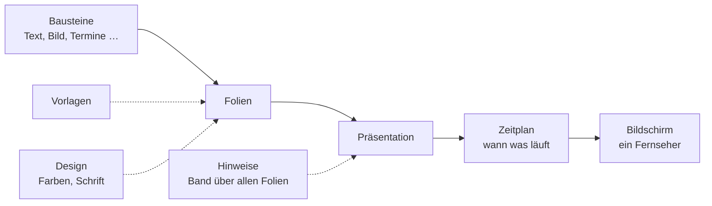
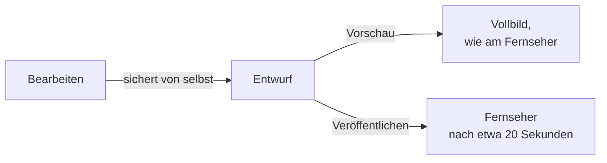

# Der Infoscreen Designer in Bildern

Was der Designer kann, auf einen Blick – für Gemeinden, die überlegen, ob er zu ihnen passt, und für alle, die ihn
neu kennenlernen. Wie man ihn einrichtet, steht in der [Einrichtungsanleitung](Einrichtung.md), wie man damit
arbeitet, im [Onboarding](Onboarding.md). Einzelheiten zu jeder Einstellung zeigt im Designer das türkise „?“.

**Alle Bilder zeigen eine erfundene „Gemeinde am Markt"** mit ausgedachten Terminen, Gruppen, Namen und Bildern –
nichts davon stammt aus einer echten ChurchTools-Instanz.

## So hängt alles zusammen

Ein **Bildschirm** steht für einen Fernseher. Was er zeigt, ist eine **Präsentation** aus **Folien**, und jede Folie
besteht aus **Bausteinen**. Ein **Zeitplan** legt fest, wann welche Präsentation läuft. **Design**, **Vorlagen** und
**Hinweise** gelten für viele Folien zugleich.

## Die Bildschirme

Jeder Fernseher ist eine Kachel mit dem, was er gerade zeigt, und der Angabe, ob er **„online"** ist. Ein Klick
öffnet die laufende Präsentation im Editor; Adresse und Zeitplan stecken im Menü „…".

## Der Editor

Folien gestalten wie in einem Folienprogramm: links die Folien, oben „+ Baustein", in der Mitte die Bildfläche, rechts
die Einstellungen. Ziehen, skalieren, drehen, ausrichten, kopieren, rückgängig machen – beim Ziehen zeigt die
Bildfläche die Abstände und rastet ein. Über dem gewählten Baustein steht ein **Kurzmenü** mit dem Wichtigsten, ein
**Doppelklick** führt zum Inhalt: Text schreibt man direkt auf der Folie.

Neu hier? Eine kurze **Einführung** zeigt die wichtigsten Stellen, und das türkise **„?“** an jedem Bereich erklärt
seine Einstellungen.

**Gestalten:** Bilder lassen sich zuschneiden, abdunkeln und mit runden Ecken und Schatten versehen, Text bekommt
Schatten oder eine farbige Hinterlegung. Farben kommen aus der Palette der Gemeinde, damit alles zusammenpasst.

**Mehrere Bausteine** wählt man mit Umschalt-Klick oder einem Auswahlrahmen, richtet sie gemeinsam aus, verteilt sie
gleichmäßig oder **gruppiert** sie. Die Liste „Bausteine dieser Folie" erreicht auch, was verdeckt liegt.

**Aufteilung:** Eine Folie lässt sich in Bereiche gliedern – halb und halb oder zwei Drittel zu einem Drittel, auf
Wunsch mit Kopf- und Fußzeile. Ein Baustein, den man in einen Bereich setzt, füllt ihn genau aus und wandert mit, wenn
sich die Aufteilung ändert.

## Die Bausteine

Siebzehn Bausteine stehen unter „+ Baustein" zur Wahl, jeder mit einem Satz, was er zeigt:

| Gruppe | Bausteine |
| --- | --- |
| Gestalten | Text, Bild, Fläche, Linie, QR-Code, Uhr, Countdown |
| Termine aus ChurchTools | Terminliste, Nächster Termin |
| Mehr aus ChurchTools | Gruppen, Beiträge, Raumbelegung, Gemeindekopf mit Logo |
| Medien und mehr | Galerie, Video, Webseite, Social Media |

Bausteine, die mehrere Seiten haben – etwa eine lange Terminliste –, wechseln von selbst; ein dünner **Fortschritt**
zeigt, wann die nächste Seite kommt.

### Termine

Termine kommen live aus den **öffentlichen Kalendern** von ChurchTools; einzelne interne Kalender kann ein
Administrator freigeben. Die **Terminliste** zeigt sie als Zeilen, als Karten oder als **Besucherübersicht** fürs
Foyer – mit dem Raum, in den man gehen muss. Auf Wunsch stehen am Termin die gebuchten **Räume** und die **Dienste**
(„Predigt: Anna Beispiel"); Dienste erscheinen nur nach Freigabe durch einen Administrator. Termine mit bestimmten
Tags, etwa „Intern", lassen sich ausblenden.

### Gruppen

Die Gruppen der Gemeinde direkt aus einer **Gruppen-Homepage** von ChurchTools – mit Bild, Termin, freien Plätzen,
auf Wunsch der Leitung und einem **QR-Code zum Anmelden**. Gezeigt wird nur, was die Homepage ohnehin öffentlich zeigt.

### Beiträge

Die neuesten Beiträge öffentlicher Gruppen, mit Bild und Text so formatiert wie in ChurchTools. Welche Angaben
erscheinen, wählt man je Baustein.

### Raumbelegung

„Was ist heute im Saal los?" – die Buchungen der Räume als Übersicht oder als **Türschild** mit „Jetzt" und „Danach".
Buchungstitel lassen sich je Raum ausblenden; dann steht dort „Belegt".

### Galerie und Video

Die **Galerie** zeigt Bilder nacheinander, mit Übergängen und auf Wunsch langsamem Zoom. Das **Video** läuft als
Schleife (MP4, bis 128 MB), auf Wunsch mit Ton. Beides liegt auf dem Gerät und läuft auch ohne Netz.

### Social Media und Webseite

**Social Media** zeigt die Profile der Gemeinde mit dem Zeichen der Plattform – man fügt nur den Link ein. Die
**Webseite** bettet eine fremde Seite ein, etwa eine Karte oder Umfrage.

## Vorlagen

Was auf vielen Folien gleich aussehen soll – etwa ein Seitenkopf mit Gemeindename und Uhr –, baut ihr einmal als
**Vorlage** und setzt sie auf beliebig viele Folien. Ändert ihr die Vorlage, ändern sich alle Folien mit, sofort und
ohne „Veröffentlichen". Soll eine Folie abweichen, löst man die Vorlage dort.

**Anlegen:** Bausteine wählen, im Kurzmenü „⋯" → **„Als Vorlage speichern …"**. Danach steht sie unter „+ Baustein"
im Abschnitt „Vorlagen". **Bearbeiten:** Doppelklick auf die Vorlage oder auf der Seite „Design".

## Entwurf und Veröffentlichen

Ausprobieren ist gefahrlos: Der Editor **sichert jede Änderung von selbst als Entwurf**, die Fernseher zeigen weiter
den veröffentlichten Stand. Die **Vorschau** spielt den Entwurf im Vollbild ab – genau wie am Fernseher. Erst
**„Veröffentlichen"** bringt ihn auf die Fernseher. Der Entwurf gehört der Präsentation, nicht der Person: Wer sie als
Nächstes öffnet, arbeitet daran weiter.

## Präsentationen

Eine Präsentation kann auf mehreren Bildschirmen laufen. Beim Duplizieren entstehen eigene Folien oder auf Wunsch
verknüpfte, die sich gemeinsam ändern. Auf Wunsch zeigt ein Fortschrittsbalken, wie lange die Folie noch steht.

## Zeitpläne

Welche Präsentation ein Bildschirm wann zeigt: nach Uhrzeit („sonntags 9–12 Uhr") oder rund um Termine („30 Minuten
vor Beginn"). Eine **Zeitleiste über sieben Tage** zeigt, was wann läuft.

## Hinweise

Ein Band über allen Folien, als Laufschrift oder stehend – etwa „Heute Parkplatz gesperrt". Es verschwindet zur
eingestellten Zeit von selbst; eine Zeitleiste zeigt, wann es auf welchem Fernseher steht.

## Mediathek

Bilder und Videos einmal hochladen und überall verwenden. Unter jeder Datei steht, wo sie läuft; „Unbenutzt" hilft
beim Aufräumen, und vor dem Löschen warnt die Mediathek, wenn eine Datei noch gezeigt wird.

## Design

Einmal für alle Bildschirme: Farben, Ecken, Schrift und die Darstellung der Termine, mit Vorschau. Dazu eine
**Farbpalette** mit den Farben der Gemeinde und **eigene Schriften** – etwa die Hausschrift.

## Verlauf

Wer hat wann was veröffentlicht, angelegt oder gelöscht? Die Seite **„Verlauf"** zeigt es für die letzten 30 Tage,
eingrenzbar nach Person und Bereich.

## Am Handy und auf dem Tablet

Der Designer ist für den Finger gebaut: Die Folie bleibt im Blick, Einstellungen öffnen sich als Blatt von unten, zwei
Finger zoomen. Ein Baustein bewegt sich erst, wenn man ihn angetippt hat – so scrollt ein Wisch nicht aus Versehen etwas
weg.

## Am Fernseher

Dort gibt es nichts zu bedienen: Der Fernseher meldet sich selbst an, übernimmt Änderungen nach etwa 20 Sekunden,
zeigt bei einem Netzausfall den letzten Stand und lädt jede Nacht neu. Was er tut, wenn ChurchTools nicht erreichbar
ist, zeigt [Wenn ChurchTools ausfällt](Ausfall.md).
