# Der Infoscreen Designer in Bildern

Was der Designer kann, auf einen Blick – für Gemeinden, die überlegen, ob er zu ihnen passt, und für alle, die ihn
neu kennenlernen. Wie man ihn einrichtet, steht in der [Einrichtungsanleitung](Einrichtung.md), wie man damit
arbeitet, im [Onboarding](Onboarding.md).

**Alle Bilder zeigen eine erfundene „Gemeinde am Markt"** mit ausgedachten Terminen, Gruppen, Namen und Bildern –
nichts davon stammt aus einer echten ChurchTools-Instanz. Die Bilder entstehen automatisch
(`npm run docs:screenshots`) und lassen sich nach jeder Änderung neu erzeugen.

## Die Bildschirme

Jeder Fernseher ist eine Kachel – mit dem, was er **gerade** zeigt. Ein Klick öffnet die laufende Präsentation im
Editor; Adresse, Zeitplan und Player stecken im Menü „…", für Administratoren dazu „Umbenennen" und „Einstellungen". Filter trennen Quer- und Hochformat. Die Angaben der
Kachel stehen untereinander: zuerst, ob der Fernseher **„online"** ist – er meldet sich alle fünf Minuten –, sonst
**„nicht online seit …"** oder **„noch nie abgerufen"**; zuletzt wann und von wem sie oder ihr Zeitplan zuletzt geändert
wurde. Alle Bereiche –
Bildschirme, Präsentationen, Zeitpläne, Hinweise und Mediathek – zeigen dieselben Kacheln in derselben Breite; lange Namen
brechen um, nichts wird abgeschnitten.

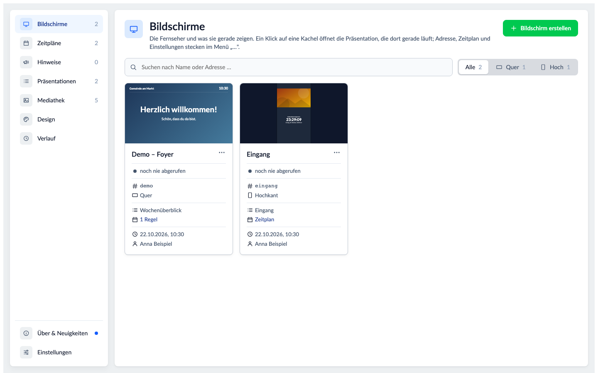

## Der Editor

Folien gestalten wie in einem Folienprogramm: links die Folien, oben „+ Baustein", in der
Mitte die Bildfläche, rechts der Inspektor: oben der Inhalt des gewählten Bausteins, darunter aufklappbare Bereiche – offen ist immer nur einer, nur „Bausteine dieser Folie" bleibt daneben stehen.
„+ Baustein" nennt zu jedem Baustein in einem Satz, was er zeigt, und hat ein Suchfeld („kalender" findet die
Terminliste). Ziehen, an den Griffen skalieren, am Raster ausrichten, sperren, rückgängig machen. **Beim Ziehen zeigt die Bildfläche die Abstände** zu den Nachbarn und zum Rand in Orange, dazu die Größe; kommt ein Abstand einem schon vorhandenen nahe, rastet er ein, und beide gleichen Abstände sind markiert. Mit gedrückter Alt-Taste über einem anderen Baustein stehen die Abstände zwischen beiden. **Kopieren, Einfügen, Duplizieren** gehen mit Strg/⌘ + C, V, D oder den Knöpfen im Inspektor, im „⋯" über dem Baustein und neben „+ Baustein" – eingefügt wird an derselben Stelle, auch auf einer anderen Folie. Alle Tastengriffe zeigt „? Hilfe" oben im Editor.

**Die Hilfe zu den Einstellungen:** Jeder aufgeklappte Bereich des Inspektors hat rechts ein türkises „?"; ebenso der Kopf des Inspektors, für alles, was in keinem Bereich steht. Ein Klick öffnet die **Hilfe-Leiste** unter der Folie (am Handy als Blatt von unten, auf der Seite „Design" unter der Vorschau): ein Reiter je Bereich, „Allgemein" zuerst, eine Suche über alle Reiter. Geschlossen wird sie mit ✕, mit Esc oder mit einem zweiten Klick auf dasselbe „?"; wechselt die Auswahl, folgt die Leiste dem neuen Baustein. „? Hilfe" → „Hilfe zu den Einstellungen" öffnet sie ebenfalls. **Mit der Maus** zeigen Symbolknöpfe und Bezeichnungen beim Überfahren einen kurzen Satz; am Tablet entfällt das, dort tragen die Knöpfe ihren Namen für den Bildschirmleser.

**Die Einführung:** Beim ersten Öffnen des Editors bietet eine Karte „Neu hier?" eine Einführung an – sechs Schritte, die Folien, „+ Baustein", die Bildfläche, den Bereich rechts, „Vorschau" und „Veröffentlichen" zeigen, ohne etwas zu verändern. Sie startet nie von selbst; ob die Karte schon da war, merkt sich der Browser. „? Hilfe" oben öffnet ein kleines Menü mit „Tastenkürzel", „Einführung" und „Hilfe zu den Einstellungen". Am Handy gibt es sie nicht.

**Das Kurzmenü:** Über dem gewählten Baustein steht ein kleines Menü mit dem, was man an ihm am häufigsten
ändert – beim Text Textstufe, Farbe und Ausrichtung, beim Bild „Bild tauschen", bei Terminen die Kalender („Kalender ·
3"). Rechts daneben Sperren, Duplizieren, Löschen und „⋯" mit Kopieren, Einfügen, den Ebenen und **„Alle
Einstellungen"**, das den Inspektor öffnet. Beim Ziehen tritt es beiseite. **Ein Doppelklick führt zum Inhalt:** Auf
einem Text schreibt man direkt auf der Folie, in derselben Schrift und Größe, die der Fernseher zeigt; auf einem Bild
öffnet er die Mediathek, auf einer Terminliste die Kalender. Ein Baustein, dem noch etwas fehlt, trägt mittig einen
Knopf wie „Bild wählen" oder „Adresse eingeben". Text gibt es in drei **Textstufen** – Überschrift, Untertitel, Text –,
für quer und hochkant gleich groß.

Termine kommen live aus den Kalendern von ChurchTools – hier als Karten mit Datumskachel und Kalenderfarbe. **Zur Wahl stehen öffentliche
Kalender** – solche, die man in ChurchTools auch ohne Anmeldung sieht; ein „Rechte aktualisieren" braucht es dafür nicht –
und einzelne nicht öffentliche, die ein Administrator in den Einstellungen für Bildschirme freigegeben hat (mit dem Zusatz „nicht öffentlich").
Interne Termine (nur für angemeldete Benutzer) zeigt kein Fernseher. Hat ein Baustein einen Kalender, der nicht
öffentlich ist, nennt ihn der Editor und bietet an, ihn zu entfernen; fehlt einer, sagt der Editor, wie man ihn in
ChurchTools freigibt.

**Suche in langen Listen:** Ab neun Einträgen steht über den Kalendern, den Gruppen der Beiträge und den Gruppen des
Bausteins „Gruppen" ein Suchfeld. Es findet Teile des Namens in ihrer Reihenfolge, wie die Schnellsuche von ChurchTools –
„haus nord" findet „Hauskreis Nord"; Groß- und Kleinschreibung zählt nicht, „ae" findet „ä". Gewählte Einträge bleiben
stehen, auch wenn sie nicht passen.

**Auswahllisten:** Wo eins aus mehreren gewählt wird – Schrift, Gruppen-Homepage, Raum, Raster, Bildformat und in der
Einrichtung –, klappt eine eigene Liste auf statt der des Browsers, überall gleich, auch am Tablet und in Safari. Ab fünf
Einträgen steht oben ein Suchfeld, das gleich den Cursor hat; mit der Tastatur wählen Pfeile, Enter und Anfangsbuchstaben.

**Termine über Tags ausblenden.** Terminliste, Nächster Termin und Countdown lassen Termine weg, die einen bestimmten
Tag tragen – etwa „Intern" oder „Probe". Unter den Kalendern steht **„Tags ausblenden"**; dort schaltet
man die Tags ein, die der Baustein auslassen soll. Tags vergibt man in ChurchTools am Termin und verwaltet sie im Kalender
über das Tag-Symbol; eine Wiederholungsserie trägt den Tag an jedem Termin. Ein Tag, den es in ChurchTools nicht mehr gibt,
steht als „Tag gelöscht" da und lässt sich abwählen. Das Gerät braucht dafür kein eigenes Recht. Zeitpläne nach Terminen
beachten Tags nicht.

**Farben aus der Palette:** An jedem Farbfeld des Editors stehen kleine Tupfer in zwei Gruppen. Zuerst die
**„Farbpalette"** – Akzent, Text und Hintergrund des Designs, dann die Palette (Seite „Design"); das ist das
Freigegebene. Darunter **„Auf der Folie"** – alle Farben, die die gerade bearbeitete Folie benutzt; eine freigegebene
trägt dort ihren Namen aus der Palette, eine abweichende nur ihren Hex-Wert. Eine leere Gruppe erscheint nicht; Farbwähler und
Hex-Feld bleiben, abweichen geht weiter. Ein Klick setzt den Hex-Wert, beim Darüberfahren steht der Name.
Die Farbe wird **kopiert**: Ändert ihr eine Palettenfarbe später, färbt die bestehenden Folien nicht um.

**Schrift:** Im Bereich „Schrift" – in jedem Baustein, der Schrift hat – steht neben Schriftart, Größe, Stärke und
Farbe das Kästchen **„Großbuchstaben"**. Ihr schreibt wie gewohnt; der Fernseher zeigt den Text in Großbuchstaben, der
gespeicherte Text bleibt, wie ihr ihn getippt habt.
Neben **„Ausrichtung"** (links, mittig, rechts) steht **„Vertikal"** – oben, mittig oder unten in der Box: bei Text,
Uhr, Countdown, Nächstem Termin und Gemeindekopf. Ohne Wahl bleibt es, wie der Baustein es bisher tat. Passt der Inhalt
nicht in die Box, beginnt er oben; der Anfang wird nie abgeschnitten. Listen füllen ihre Box Seite für Seite und haben
das Feld nicht.

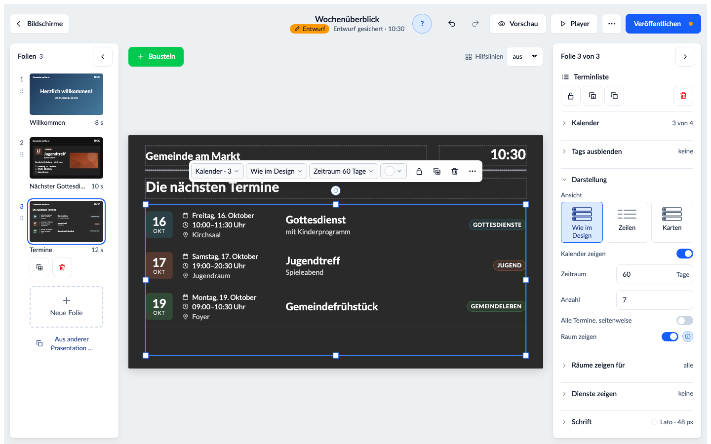

**Siebzehn Bausteine:** Text, Bild, Fläche, Linie, Galerie, Video, Uhr, Terminliste, Nächster Termin, Gemeindekopf mit
Logo, Webseite, QR-Code, Countdown, Beiträge, Gruppen, Raumbelegung und Social Media. Beim Baustein „Webseite" geht statt der Adresse auch der
Einbettungscode (`<iframe …>`), den Karten, Umfragen oder Pinnwände anbieten – übernommen wird nur die Adresse darin.
Seiten des eigenen ChurchTools bettet der Baustein nicht ein.

## Entwurf und Veröffentlichen

Ausprobieren ist gefahrlos: Der Editor **sichert jede Änderung von selbst als Entwurf** („Entwurf gesichert · 14:32"),
die Fernseher zeigen weiter den veröffentlichten Stand. Erst **„Veröffentlichen"** bringt die Änderungen auf die
Fernseher, nach etwa 20 Sekunden. Solange etwas noch nicht veröffentlicht ist, trägt die Präsentation die warme Marke
**„Entwurf"** – im Editor unter dem Titel und auf ihrer Kachel unter „Präsentationen", dort mit „von wem, wann".
Der Entwurf gehört der Präsentation, nicht der Person: Wer sie danach öffnet – am Rechner oder am Handy –, arbeitet am
selben Entwurf weiter; sichern zwei gleichzeitig, fragt der Editor, wessen Stand gelten soll. **„Entwurf verwerfen"**
im Menü „⋯" kehrt zum veröffentlichten Stand zurück. Läuft die Präsentation gerade, steht das im Editor; verknüpfte
Folien nennt ein Dialog vor dem Veröffentlichen. Entwürfe liegen in einer eigenen Ablage, die kein Fernseher lesen
darf – ein Gerät kann einen Entwurf nie zeigen (siehe [Rechte](Rechte.md)). Solange ein Administrator nach dem Update
noch nicht „Rechte aktualisieren" geklickt hat, geht jede Änderung mit „Veröffentlichen" wie früher direkt auf die
Fernseher; der Editor sagt das.

**Formen, Linien, Drehen:** Eine Fläche ist ein Rechteck mit runden Ecken oder eine Ellipse, auf Wunsch mit Rand. Die
Linie ist durchgezogen oder gestrichelt und hat Griffe nur an ihren Enden. Jeder Baustein dreht sich am Drehpfeil
unter seinem Rahmen (am unteren Rand der Folie steht er darüber); er rastet bei 0°, 45°, 90° … ein, mit Umschalt dreht er frei. Genaue Winkel und die **Deckkraft**
stehen im Inspektor unter „Drehung und Deckkraft“, „Drehen zurücksetzen“ im „⋯“ des Kurzmenüs.

**Bilder gestalten:** Ein Doppelklick auf ein Bild öffnet den **Ausschnitt** – das Bild im Rahmen verschieben, mit dem
Regler vergrößern, „Fertig“. Bei „Füllen“ bekommen Bild, Video und Galerie runde Ecken und einen weichen oder starken
Schatten; der **Ton** dunkelt ein Bild ab, hellt es auf oder macht es grau, damit Text darauf lesbar bleibt.

**Text gestalten:** Schatten (weich oder stark, immer dunkel, damit er auch auf Weiß zu sehen ist) sowie Zeilen- und Buchstabenabstand
(eng, normal, weit) hat jeder Baustein mit Schrift; beim Text kommt eine farbige **Hinterlegung** hinter jeder Zeile
dazu.

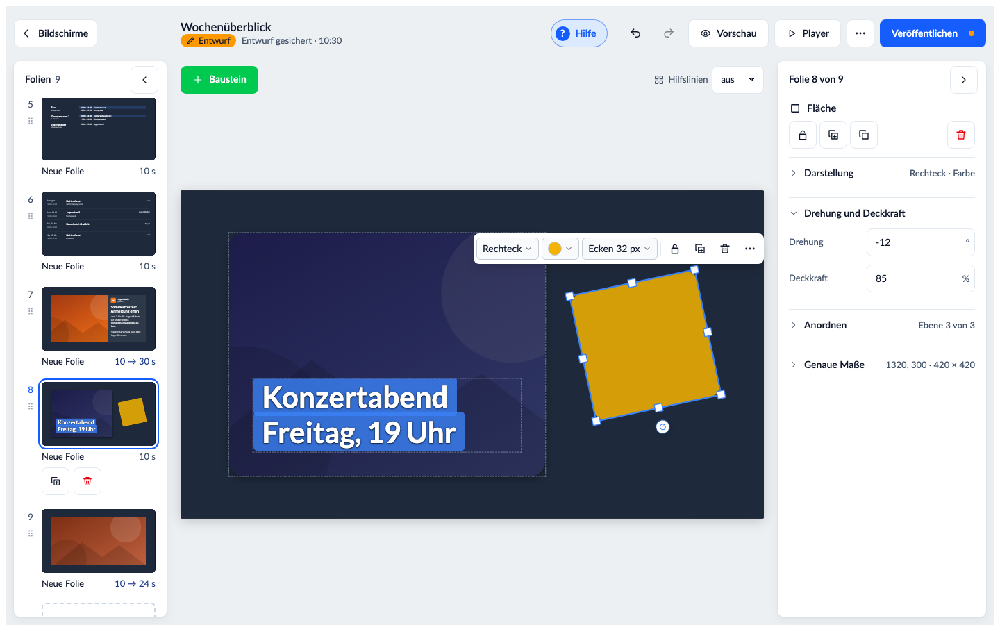

## Mehrere Bausteine

Mit Umschalt-Klick, einem **Auswahlrahmen** auf der leeren Fläche oder Strg/⌘ + A wählt man mehrere Bausteine
und zieht, kopiert, dupliziert oder löscht sie gemeinsam; eingefügt wird die ganze Gruppe in ihrer Lage zueinander.
**Ausrichten und Verteilen:** links, mittig, rechts, oben, mittig, unten, und ab drei Bausteinen gleiche Abstände –
im Kurzmenü unter „Ausrichten" und im Inspektor unter „Anordnen". Ein gesperrter Baustein bleibt stehen, die anderen
richten sich nach ihm. **Gruppieren** (Strg/⌘ + G) hält zusammen, was zusammengehört – Titel mit Uhrzeit, Bild mit
Bildunterschrift: Ein Klick wählt dann die ganze Gruppe, ein Doppelklick ein einzelnes Mitglied; beim Ausrichten
und Verteilen zählt sie wie ein einzelner Baustein. Solange nichts
gewählt ist, zeigt der Inspektor **„Bausteine dieser Folie"**, oben = vorne: Ein Klick wählt, das Schloss sperrt,
Ziehen ändert die Ebene – so erreicht man auch, was ganz verdeckt liegt. Eine Gruppe ist dort eine Zeile, die sich
aufklappen lässt; ihre Mitglieder ordnet man darin untereinander, und „vorn/hinten" eines einzelnen Mitglieds bleibt
innerhalb der Gruppe.

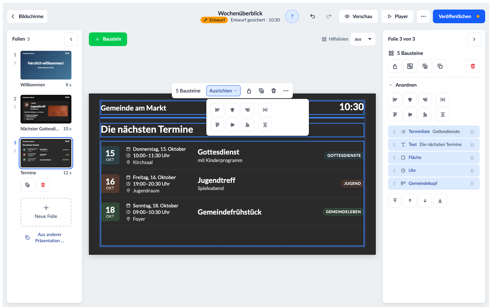

## Vorlagen

Was auf vielen Folien gleich aussehen soll – etwa ein Seitenkopf mit Name der Gemeinde und Uhrzeit –, baut ihr einmal
als **Vorlage** und setzt sie auf beliebig viele Folien. Ändert ihr die Vorlage, ändern sich alle diese Folien mit.

**Eine Vorlage anlegen:** Auf einer Folie die Bausteine wählen (mit gedrückter Umschalttaste mehrere), im Kurzmenü über
den Bausteinen „⋯" öffnen und **„Als Vorlage speichern …"** wählen, dann einen Namen geben. Aus den Bausteinen wird ein
einziger Vorlagen-Baustein.

**Auf weitere Folien setzen:** „+ Baustein" zeigt unten den Abschnitt **„Vorlagen"** – angeboten werden die Vorlagen im
Format der Präsentation (quer oder hochkant). Die Vorlage erscheint an der Stelle, an der sie gebaut wurde; das gilt auch
für Kopieren und Einfügen. Auf der Folie lässt sie sich verschieben, Größe und Inhalt kommen aus der Vorlage.

**Ändern – für alle Folien zugleich:** Doppelklick auf die Vorlage, „Vorlage bearbeiten" im Inspektor oder im Kurzmenü.
Der Rest der Folie wird blass; die Bausteine der Vorlage bearbeitet ihr wie gewohnt, „+ Baustein" fügt neue hinzu, und
der gestrichelte Rahmen lässt sich an der rechten und unteren Kante ziehen. Die Leiste oben sagt, auf wie vielen Folien
die Vorlage steht. **„Fertig"** speichert, **„Abbrechen"** verwirft. Die Änderung gilt **sofort auf allen Folien und
Bildschirmen** mit dieser Vorlage – ohne „Veröffentlichen".

**Fest an ihrer Stelle:** Eine Vorlage aus gesperrten Bausteinen ist auf jeder Folie gesperrt und steht überall an
derselben Stelle; auf einer einzelnen Folie lässt sie sich nicht entsperren. Ein- und ausschalten lässt sich das im
Bearbeiten-Modus mit dem Schalter **„Fest an ihrer Stelle"**. Bearbeiten geht trotzdem.

**Lösen:** Soll eine Folie abweichen, wählt ihr dort **„Lösen"**. Aus der Vorlage werden eigene Bausteine nur für diese
Folie; spätere Änderungen an der Vorlage erreichen sie nicht mehr. Kopiert ihr eine Vorlage in eine Präsentation
anderen Formats, kommt sie dort ebenfalls gelöst an.

**Auf der Seite „Design"** stehen alle Vorlagen mit Vorschau, Format und der Zahl der Folien. **„Bearbeiten"** öffnet
eine Vorlage direkt, ohne die Folie suchen zu müssen; „Fertig" führt zurück. Dort lassen sie sich auch umbenennen und
löschen – löschen aber erst, wenn keine Folie und kein Entwurf sie mehr benutzt; sonst nennt die Meldung die
Präsentationen.

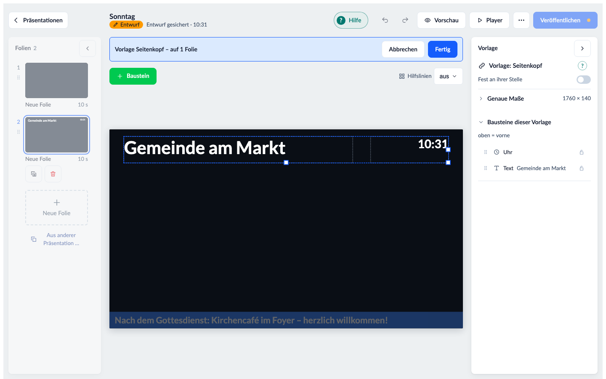

## Aufteilung

Eine Folie lässt sich in **Bereiche** gliedern, damit Bausteine sauber nebeneinander stehen: Im Inspektor der Folie
(nichts gewählt) öffnet ihr **„Aufteilung"** und wählt **Halb und halb**, **Zwei Drittel / ein Drittel** oder umgekehrt –
auf einer querformatigen Folie in Spalten, auf einer hochkant in Zeilen. Dazu gibt es die Schalter **„Kopfzeile"** und
**„Fußzeile"**. Unter **„Abstand"** wählt ihr **Ohne**, **Eng**, **Normal** oder **Weit** – er gilt zwischen den
Bereichen und zum Rand der Folie; „Ohne" reicht bis an den Rand. Eng, Normal und Weit sind 20, 40 und 60 px, genau die
Weiten des Rasters, und alle Kanten der Bereiche liegen auf dem 20er-Raster – wer mit Raster gestaltet, trifft beides. Die Bereiche erscheinen im Editor als gestrichelte Rahmen unter den Bausteinen; in Vorschau, Miniaturen
und auf dem Bildschirm sind sie nicht zu sehen. Bausteine rasten an den Kanten und Mitten der Bereiche ein.

In einem **leeren** Bereich steht ein „+": Es öffnet „+ Baustein", und der gewählte Baustein füllt den Bereich. In
Kopf- und Fußzeile stehen dabei die Vorlagen vorn (die Vorlage behält ihre eigene Größe und sitzt an der linken oberen
Ecke des Bereichs). Wechselt ihr die Aufteilung, bleiben freie Bausteine, wo sie sind. Neue Folien beginnen ohne
Aufteilung.

Was über das „+" in einen Bereich kommt, ist dort **fest**: Der Baustein lässt sich nicht verschieben und nicht in der
Größe ändern, der Inhalt bleibt bearbeitbar. Unter „Anordnen" löst der Schalter **„Im Bereich fest"** die Bindung (oder
bindet einen Baustein, dessen Mitte in einem Bereich liegt). Wechselt ihr die Aufteilung oder den Abstand, **wandern feste Bausteine mit**
und nehmen den Rahmen ihres Bereichs an; fällt der Bereich weg, bleibt der Baustein stehen und ist wieder frei. Kopien
eines Bausteins sind immer frei. Wer einen vorhandenen Baustein in einen **leeren** Bereich zieht, setzt ihn dort
fest (der Bereich unter dem Mauszeiger oder Finger ist beim Ziehen hervorgehoben); in einem belegten Bereich bleibt er frei.
Ein Hintergrund über die ganze Folie belegt keinen Bereich. Wer einen Baustein mit „Im Bereich fest" gelöst hat, kann ihn in
seinem Bereich frei verschieben, ohne dass er wieder einrastet.

## Galerie

Bilder aus der Mediathek nacheinander, mit vier Übergängen (Überblenden, Schieben, Aufdecken oder harter Schnitt). Dazu zoomt jedes Bild auf Wunsch langsam hinein, heraus oder abwechselnd (Feld „Bewegung"). Mehrere Bilder auf einmal wählen, mit ↑/↓
sortieren, Dauer je Bild und Einpassen (Ganz zeigen oder Fläche füllen) unter „Darstellung" einstellen. Die Folie läuft, bis jedes Bild
einmal zu sehen war; höchstens 30 Bilder. Die Bilder liegen auf dem Gerät, die Galerie läuft auch ohne Netz.

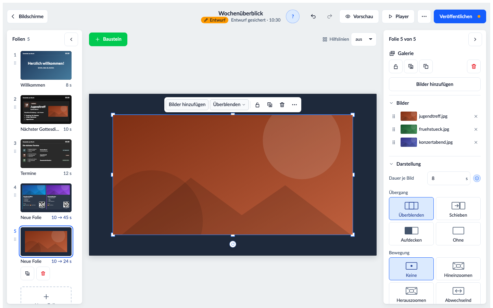

## Video

Ein Video aus der Mediathek, als Endlosschleife und von vorn bei jedem Durchlauf der Folie. Hochgeladen wird **MP4 mit
H.264, bis 128 MB**; das Video bleibt, wie es ist – es wird nicht umgerechnet. Der **Ton** lässt sich je Baustein
einschalten (Vorgabe: aus); er startet nur, wenn der Browser des Fernsehers es erlaubt, sonst läuft das Video stumm.
Die Folie dauert mindestens so lange wie das Video. Der Fernseher lädt die Videos einer Präsentation gleich mit ihr auf
das Gerät. Danach laufen sie auch ohne Netz, solange der Speicher des Geräts reicht. Passt ein Video nicht mehr hinein,
kommt es weiter aus dem Netz. Zum Laden braucht das Gerät das Recht „Wiki-Bereich „Infoscreen" sehen" – der Assistent
vergibt es. In der Vorschau laufen Videos stumm; ein Knopf am Video schaltet den Ton zu. Auf einem Kiosk-Gerät noch
nicht im Dauerbetrieb geprüft.

## Gruppen aus ChurchTools

Was es in der Gemeinde für Gruppen gibt – direkt aus einer **Gruppen-Homepage** von ChurchTools, ohne doppelte
Pflege. Je Gruppe Name, Bild, Wochentag und Uhrzeit, Zielgruppe, Kategorie, Beschreibung, freie Plätze, auf Wunsch
die Leitung mit Bild und ein **QR-Code auf die öffentliche Gruppenseite** zum Anmelden. Jede Angabe lässt sich
einzeln abschalten; ein bis vier Gruppen je Seite, oder als Liste. Die Gruppen stehen nach Wochentag (Montag zuerst)
oder nach Name, auf- oder absteigend – oder in einer eigenen Auswahl und Reihenfolge.

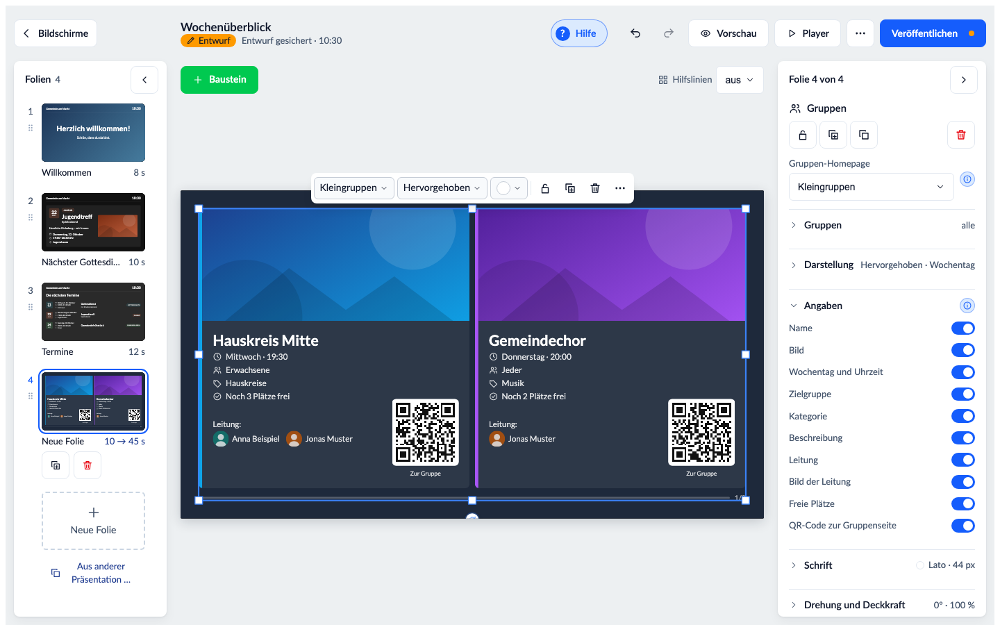

Gezeigt wird nur, was ChurchTools auf der Gruppen-Homepage ohnehin öffentlich zeigt.

Die Beschreibung erscheint formatiert, wie sie im Editor von ChurchTools steht: fett, kursiv, durchgestrichen, Überschriften, Listen und Zitate; Erwähnungen (@Person, @Gruppe) als Name. Tabellen und Bilder im Text fehlen; auf der Karte steht jeder Listenpunkt in einer eigenen Zeile.

## Raumbelegung

„Was ist heute im Saal los?" – die Buchungen der **Räume** aus ChurchTools, als **Übersicht** aller gewählten Räume oder
als **Türschild** des ersten Raums: „Jetzt" mit Titel und Ende oder „Frei" (mit „bis 14:00", wenn noch etwas kommt),
darunter „Danach" mit den nächsten Buchungen. Die laufende Buchung ist hervorgehoben; ein Zeitraum von 1 bis 14 Tagen ab heute (ab übermorgen steht der Wochentag mit Datum vor der Zeit);
ein **Wegweiser** je Raum („1. OG, links"). Gewählt werden nur Räume, nicht Gegenstände und Fahrzeuge. Was ein Raum ist,
legt der Ressourcentyp fest – vorgegeben ist „Raum"; wo es ihn nicht gibt, wählt ein Administrator unter **Einstellungen
→ Räume** die passenden Typen, und bis dahin sagt der Baustein, dass das fehlt. Die Übersicht
wechselt seitenweise, die Folie bleibt, bis alle Seiten gelaufen sind.

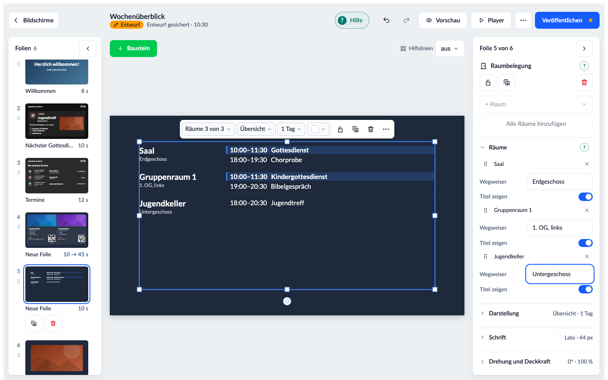

Nur bestätigte Buchungen erscheinen, und nur Raum, Zeit und Titel – nie Beschreibung, Notizen oder Namen der Buchenden.
Weil ein Titel Namen enthalten kann („Gespräch Familie X"), lässt er sich **je Raum abschalten**; dann steht dort
„Belegt". Die Rechte dafür vergibt der Assistent (siehe [Rechte](Rechte.md)).

## Social Media

Die Profile der Gemeinde auf einen Blick: links das **Zeichen** der Plattform, rechts der **Name**, unter dem man sie in der
App findet. Man fügt nur den **Link** ein – Zeichen und Name erkennt der Baustein daran. Er kennt Instagram, Facebook,
YouTube, TikTok, X, Threads, WhatsApp, Telegram, Signal, Spotify, Apple Podcasts, SoundCloud, Bluesky, Mastodon, Twitch,
Pinterest und Vimeo; eine E-Mail-Adresse bekommt einen Brief, jede andere Seite einen Globus mit ihrer Adresse als Name.
Aus `instagram.com/wirsindcgks` wird „wirsindcgks", ohne „@" davor. Wer einen anderen Text will, trägt ihn je Profil unter
„Angezeigter Name" ein.

Die Zeichen liegen im Programm: Der Fernseher fragt keine fremde Seite an und zeigt sie auch ohne Netz. Mit **Markenfarben**
(Vorgabe) steht jedes Zeichen weiß auf einer Kachel in der Farbe der Plattform; ohne sie steht es allein in der Textfarbe.
Die Profile stehen **untereinander** oder **nebeneinander**, bis zu zwölf je Baustein, in der Reihenfolge der Liste. Eine
Zeile bricht nicht um; ein zu langer Name endet mit „…". Unter **„Schrift"** gibt es dieselben Einstellungen wie bei
Uhr und Countdown, mit der Ausrichtung waagerecht wie senkrecht. Untereinander
richtet sie die Zeilen aus, nebeneinander die ganze Reihe. Ein QR-Code je Profil gehört nicht dazu – dafür gibt es den
Baustein „QR-Code".

## Darstellungen der Terminliste

Die **Terminliste** bietet unter **„Darstellung“** neben „Wie im Design“, „Zeilen“ und „Karten“ die
**„Besucherübersicht“**. Sie ist vor allem für die Orientierung von Besuchern auf einem Display im
Eingangsbereich des Gemeindezentrums gedacht: Datum und Uhrzeit stehen links übereinander, Titel
und Untertitel in der Mitte und rechtsbündig der Raum, in den man gehen muss.

| Darstellung | Schwerpunkt |
| --- | --- |
| Zeilen | Kompakte Übersicht mit Datum, Uhrzeit und Titel in einer Zeile; Ort/Raum auf Wunsch rechts |
| Karten | Datumskachel, Kalenderkennzeichnung, Untertitel und auf Wunsch Dienste; ein eingetragener Ort hat Vorrang vor Räumen |
| Besucherübersicht | Großzügige Zeilen mit Untertitel; rechts der gebuchte Raum, ohne Raum der eingetragene Ort |

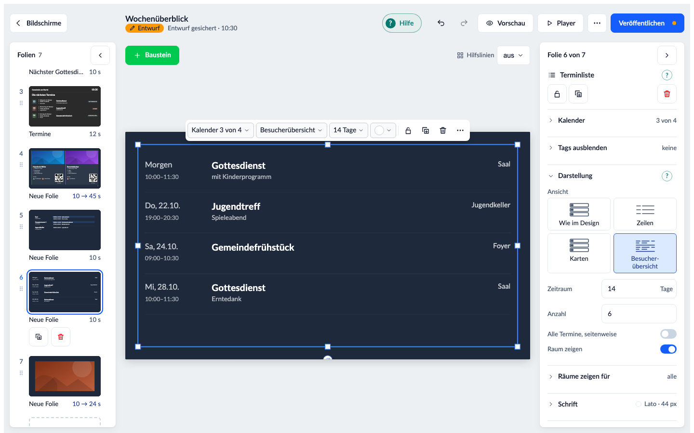

Kalender, Zeitraum, Schriftfarbe und Raumauswahl sind die vorhandenen Einstellungen der Terminliste.
Die Raumauswahl bestimmt, welche Raumnamen genannt werden; sie entfernt keine Termine. Anders als in
Zeilen und Karten geht hier der Raum vor den Ort: Wer im Foyer steht, sucht den Weg im Haus, und als Ort
stünde oft überall derselbe Gemeindename. Ohne genannten Raum steht der Ort, ohne beides bleibt die
rechte Spalte leer. Hintergrund und Schriftfarbe folgen den vorhandenen
Einstellungen; eine zusätzliche Hell-/Dunkelwahl gibt es nicht.

Mit **„Alle Termine, seitenweise“** nutzt auch die Besucherübersicht die Seitenschaltung der Terminliste.
Die Dauer je Seite ist einstellbar; die segmentierte Fortschrittsanzeige zeigt die aktuelle Seite und
ihren zeitlichen Fortschritt. Die Folie bleibt mindestens so lange sichtbar, bis alle Seiten gezeigt
wurden. Im Designer bleibt die erste Seite stehen.

## Fortschritt der Seiten

Wechselt ein Baustein von selbst, zeigt ein dünner Balken unten, wann die nächste Seite kommt. Unter **„Darstellung“**
schaltet **„Fortschritt“** ihn ein oder aus, direkt unter der Dauer. Den Schalter gibt es dort, wo der Baustein
wechseln kann:

| Baustein | Wann | Ohne Angabe (wie bisher) |
| --- | --- | --- |
| Terminliste | bei „Alle Termine, seitenweise“ | an |
| Gruppen | immer | an |
| Raumbelegung | als Übersicht | an |
| Beiträge | als „Hervorgehoben“ | aus |
| Galerie | immer | aus |

Zum Balken gehört bei allen Bausteinen die Seitenzahl („2/3“) – bei Beiträgen die Nummer des Beitrags, bei der Galerie
die des Bildes –, bei der Besucherübersicht stattdessen die Segmente (siehe „Form“ unten). Bei Terminliste, Gruppen und Raumbelegung nimmt
**Aus** die ganze Zeile weg, und der Platz geht an die Inhalte – es passt oft eine Zeile mehr auf die Seite. Der Takt bleibt in allen Fällen, wie er ist; der Balken läuft
unabhängig von dem der Präsentation, der bei Bedarf zusätzlich läuft (Abschnitt „Fortschritt“ der Folie; ein Hinweis unter dem Schalter führt dorthin). Bestehende Folien sehen aus wie vorher.

Bei eingeschaltetem Fortschritt wählt **„Form“** darunter: **„Balken“** ist eine Spur, die sich je Seite füllt, abgesetzt mit
Seitenzahl; **„Segmente“** zeigt einen Abschnitt je Seite, Beitrag oder Bild – abgeschlossene voll, den laufenden sich füllend, die
folgenden blass –, ohne Zahl. Ohne Angabe zeigt die Besucherübersicht Segmente, alles andere den Balken. Im Editor stehen Balken und
laufendes Segment still bei 40 %, sobald es mehr als eine Seite gäbe. Danach wählt **„Lage“**, wo der Balken liegt: **„Abgesetzt“** (Vorgabe) ist die Pille mit
blasser Spur, etwas über dem Rand; **„Am Rand“** ist eine dünne Linie in gleicher Stärke über die ganze Breite des Bausteins,
bündig an der Unterkante, ohne Rundung und ohne Seitenzahl – beides für Balken wie Segmente. Abgerundete Ecken des Bausteins schneiden die
Linie mit ab. Die Terminliste hält dafür weniger Platz frei. Die Besucherübersicht mit der Form „Balken“ zeigt den Balken mit Zahl in ihren Innenabständen.

## Der Raum am Termin

Beim **Nächsten Termin** und bei der **Terminliste** – als Karten wie als Zeilen – zeigt der Schalter **„Raum zeigen"** die
gebuchten Räume, mit der Pin-Nadel: „Saal, Raum 01". In der Zeilenform stehen sie rechtsbündig am Ende der Zeile; ein zu
langer Text endet mit „…". Ist am Termin ein Ort eingetragen, steht nur dieser – wie im WordPress-Plugin, damit
nichts doppelt steht; die Räume springen ein, wo kein Ort gepflegt ist. Nur bestätigte Buchungen von Räumen zählen, und am Termin
steht nur der Raumname, nie ein Buchungstitel. Das Gerät braucht dafür das Recht, alle Räume zu sehen – „Rechte
aktualisieren" gibt es ihm (siehe [Rechte](Rechte.md)).

Welche Räume genannt werden, bestimmt der Bereich **„Räume zeigen für"**, sobald „Raum zeigen" an ist. Unter **„Räume"**
steht jeder Raum von ChurchTools als Schalter, anfangs alle an; ein abgeschalteter Raum wird nur **nicht genannt** – der
Termin bleibt in der Liste. So lassen sich Verwaltung oder Lagerraum weglassen, und ein Raum, der später dazukommt,
erscheint von selbst. Zwei Bildschirme können für denselben Termin verschiedene Räume zeigen, je nach Baustein. Hat der
Baustein mehrere Kalender, lässt sich unter **„Kalender"** außerdem je Kalender abschalten – etwa wo für einen Termin viele
Räume gebucht werden. Listen in Zeilen, die es schon vor dieser Version gab, zeigen die Räume erst, wenn man „Raum
zeigen" dort einmal neu einschaltet. Nach den Terminen filtern die Schalter nicht; dafür gibt es die Raumbelegung.

**Kalender zeigen.** In der Kartenform der Terminliste und beim Nächsten Termin als Karte steht der Kalender als farbiges
Etikett. Wer es nicht braucht, schaltet **„Kalender zeigen"** unter der Darstellung ab; die Karte nutzt den Platz dann für
den Titel. Die Farbe des Kalenders bleibt an der Datumskachel.

## Die Dienste am Termin

Beim **Nächsten Termin** und bei der **Terminliste als Karten** zeigt „Dienste zeigen", wer einen Dienst übernimmt –
„Predigt: Anna Beispiel · Moderation: Ben Muster" –, in einer eigenen Zeile mit einem Personen-Symbol (in der Liste unter Titel und Untertitel).
Gewählt wird je Baustein aus den Diensten, die ein Administrator unter **Einstellungen → Dienste auf Bildschirmen** freigegeben hat;
ohne Freigabe erscheint kein Dienst. Gezeigt werden nur **zugesagte** Einteilungen und nur
Dienste aus Dienstgruppen, die in ChurchTools „Ohne Berechtigung einsehbar" sind; was eine Gemeinde dort verborgen hält,
bleibt auch am Fernseher verborgen, und am Termin stehen nur Name und Dienst, nie ein Foto oder ein Kommentar. Das Gerät
braucht dafür das Recht, die Events der Kalender zu sehen – „Rechte aktualisieren" gibt es ihm (siehe [Rechte](Rechte.md)).

## Die Vorschau – genau wie am Fernseher

„Vorschau" spielt die Präsentation mit allen noch nicht veröffentlichten Änderungen im Vollbild ab: dieselben Bausteine, derselbe
Wechsel, dieselben Daten wie am Fernseher. Die Gruppen wechseln seitenweise; die Folie bleibt, bis alle Seiten
gelaufen sind.

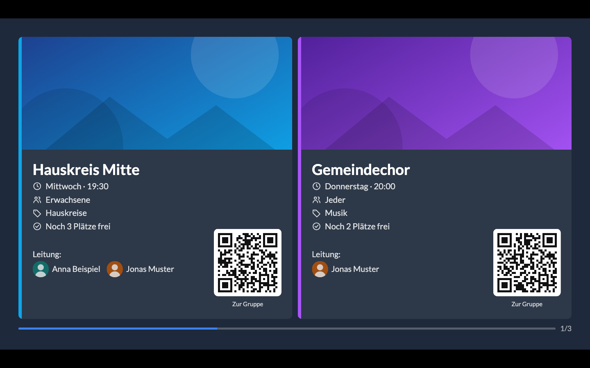

## Beiträge aus ChurchTools

Die neuesten Beiträge öffentlicher Gruppen – mit Bild, Gruppe und Alter des Beitrags, einer nach dem anderen oder als
Liste. Abgelaufene Beiträge erscheinen nie; den Namen der Autorin oder des Autors zeigt der Baustein nur, wenn man es
einschaltet.

Im Klappmenü „Angaben“ wählt der Bildschirm, was er zeigt: Gruppe, Titel, Bild, Text, Name und Datum. Was aus ist, nimmt
keinen Platz; bleibt kein Text übrig, füllt das Bild die Karte. Das Bild lässt sich „Füllen“ – mit einem Ausschnitt (Mitte,
oben, unten, links, rechts), der beim Zuschneiden sichtbar bleibt – oder „Ganz zeigen“; dann wählt der Baustein unter den
Bildern eines Beitrags das, das am wenigsten Rand lässt. Die Einstellungen gelten für alle Beiträge des Bausteins, der
Beitrag in ChurchTools bleibt, wie er ist.

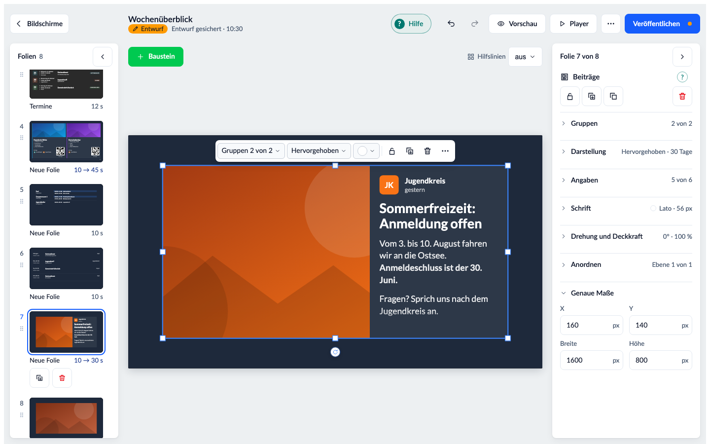

Der Text eines Beitrags erscheint formatiert, wie er im Editor von ChurchTools steht: fett, kursiv, durchgestrichen, Überschriften, Listen und Zitate; Erwähnungen (@Person, @Gruppe) als Name. Tabellen und Bilder im Text fehlen. Dasselbe gilt für die Beschreibung eines Termins, dort ohne Formatierung auf einer Zeile.

## Hinweise

Ein Band über allen Folien – als Laufschrift oder stehend, etwa „Heute Parkplatz gesperrt". Es läuft auf den
gewählten Präsentationen und verschwindet zur eingestellten Zeit von selbst. Jeder Hinweis ist eine Kachel mit einer
**Zeitleiste über die nächsten sieben Tage**: Sie zeigt, wann er tatsächlich am Fernseher steht – also wann eine
seiner Präsentationen laut Zeitplan auf einem Bildschirm läuft, bis zu seinem Ende. Darunter steht jeder Bildschirm in einer
eigenen Zeile; fährt man darüber, leuchten seine Zeiten auf. Steht ein Hinweis in den sieben Tagen auf keinem
Fernseher, sagt die Kachel das. Jeder Hinweis zeigt auch, wann und von wem er zuletzt geändert wurde; das Veröffentlichen
einer Folie zählt dabei nicht.

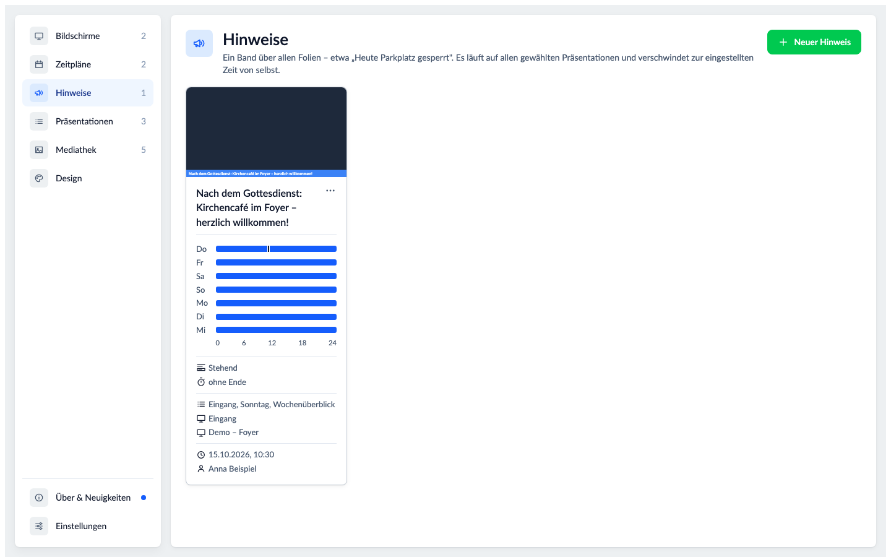

## Präsentationen

Eine Präsentation ist der Inhalt eines Bildschirms und kann auf mehreren Bildschirmen laufen. Duplizieren ergibt eine Kopie mit
eigenen Folien – oder auf Wunsch eine Präsentation mit denselben, verknüpften Folien. Jede Kachel zeigt, wann die
Präsentation oder eine ihrer Folien zuletzt geändert wurde und von wem; liegt ein Entwurf vor, trägt sie die Marke
„Entwurf". Im Inspektor der Folie, ganz oben im Abschnitt „Fortschritt", zeigt der Schalter „Fortschrittsbalken" am unteren Rand der
Bildfläche einen dünnen Balken in der Akzentfarbe des Designs, der anzeigt, wie lange die Folie noch steht, daneben die wievielte
Folie es ist („3/7“, ab zwei Folien); er hält zum unteren Rand denselben Abstand wie zu den Seiten und sitzt über dem Hinweisband, wenn dieses unten steht, und steht still, solange die Vorschau angehalten ist. Darunter wählt **„Form“** wie bei den Bausteinen zwischen **„Balken“** (Vorgabe) und **„Segmente“** (ein Abschnitt je Folie, ohne Foliennummer), dann **„Lage“** wie bei den Bausteinen zwischen **„Abgesetzt“** (Vorgabe) und **„Am Rand“**: eine dünne Linie über die ganze Breite, bündig an der Unterkante der Bildfläche (über einem unten stehenden Hinweisband), ohne Rundung und ohne Foliennummer. Auf der Folie im Editor steht er bei 40 % (nur zum Ansehen, ohne Wirkung), damit man sieht, wo er liegt.

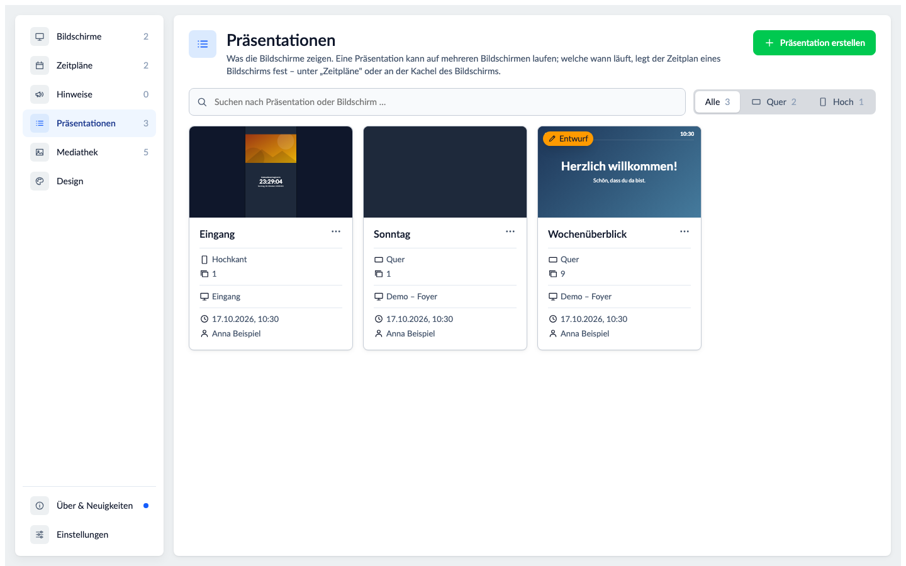

## Zeitpläne

Welche Präsentation ein Bildschirm wann zeigt: nach Uhrzeit („sonntags 9–12 Uhr") oder rund um Termine („30 Minuten vor
Beginn bis 10 Minuten nach Beginn"). Jeder Bildschirm ist eine Kachel mit der Präsentation, die gerade läuft, und einer
**Zeitleiste über die nächsten sieben Tage** – heute oben, mit einer Nadel für jetzt, jede Präsentation in ihrer Farbe
wie im Zeitplan-Dialog. Darunter die Regeln in denselben Farben: Fährt man über eine Regel, leuchten ihre Zeiten
auf; ein Klick auf eine Regel oder einen Abschnitt zeigt deren Präsentation im Bild. Zuletzt steht, wann und von wem
der Zeitplan oder der Bildschirm zuletzt gespeichert wurde.

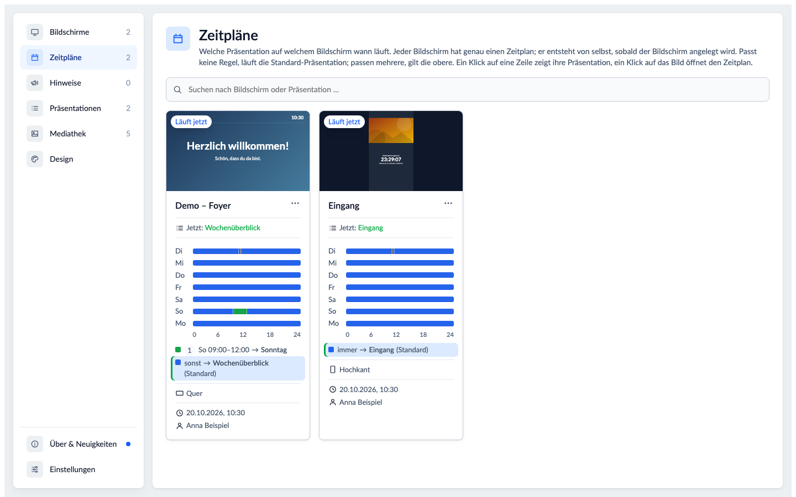

## Mediathek

Bilder und Videos einmal hochladen und überall verwenden. Unter jedem Bild steht, wo es läuft; „Unbenutzt" hilft beim
Aufräumen. Darunter steht, wann und von wem die Datei hochgeladen wurde – so, wie ChurchTools es an der Datei führt. Videos zeigen ein Standbild mit ihrer Länge. Ein Klick auf eine Kachel öffnet die Datei groß – so, wie ein Fernseher sie zeigt –
mit Maßen, Länge und Datum, auf dunklem, hellem oder kariertem Grund; mit den Pfeiltasten blättert man durch die gerade sichtbaren
Dateien. Im Auswahl-Dialog des Editors öffnet das Auge auf der Kachel die Vorschau, dort steht auch „Verwenden".

Zum Aufräumen wählt man eine oder mehrere Dateien über das Kästchen auf der Kachel und löscht sie gemeinsam;
eine einzelne löscht auch „…" → „Löschen" an ihrer Kachel. Vorher
nennt ein Dialog jede Datei – und zu jeder, die noch auf einer Folie läuft, die Stelle. Verwendete Dateien lassen sich
dabei aussparen („Nur unbenutzte löschen").

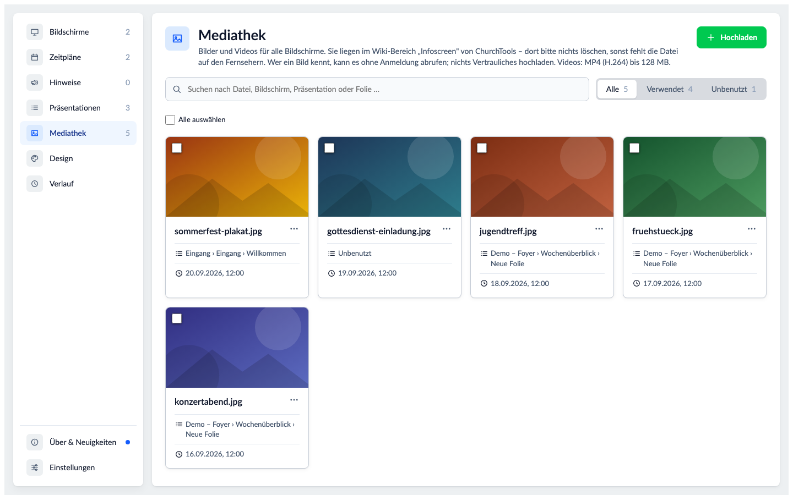

## Design

Einmal für alle Bildschirme: Ecken, Akzentfarbe, Farben und Schrift für neue Bausteine, Termine schlicht oder als Karten,
das Format der Bilder – mit Vorschau. Die Einstellungen stehen in vier Klappmenüs – **Farben**, **Ecken und Karten**,
**Schrift** und **Termine** –, die zugeklappt in Worten sagen, was eingestellt ist; offen ist immer nur eins. Dazu eine **Farbpalette**: bis zu zwölf Farben der Gemeinde mit Namen
(„Gemeindeblau"), in einer Reihenfolge, die ihr selbst bestimmt. Der **Kartenhintergrund** – leicht getönt, ohne oder
in einer eigenen Farbe mit Deckkraft – gilt für die Karten von „Nächster Termin" (Form „Modern"), „Beiträge" und
„Gruppen" sowie die Tür-Anzeige der Raumbelegung. Unter **„Vorlagen"** stehen die [Vorlagen](#vorlagen) zum Bearbeiten,
Umbenennen und Löschen – in einer eigenen Karte, weil sie sofort wirken und nicht mit „Speichern" oben gespeichert werden.

**Eigene Schriften:** Im Klappmenü „Schrift" lädt „Schrift hochladen" die Hausschrift der Gemeinde hoch. Erlaubt sind
WOFF2, WOFF, TTF und OTF bis 5 MB je Datei; eine Datei, die der Browser nicht als Schrift lädt, geht nicht hoch. Eine
Schrift hat bis zu drei Dateien: **Normal** (Pflicht), **Halbfett** und **Fett**. Fehlt ein Schnitt, nimmt der Browser
den nächsten vorhandenen. Den Namen schlägt der Designer aus dem Dateinamen vor, ihr ändert ihn im Feld. Die Schrift
steht danach in jeder Schriftauswahl unter „Eigene Schriften", jede in sich selbst gezeigt. Die Liste gilt erst mit
„Speichern". „Löschen" nennt vorher, wo die Schrift verwendet wird; dort zeigt der Fernseher danach Lato. Die Dateien
liegen im Wiki-Bereich, erscheinen aber nicht in der Mediathek, und der Fernseher legt sie auf dem Gerät ab: Die Schrift
läuft auch ohne Netz. Ladet nur Schriften hoch, die die Gemeinde auf Bildschirmen zeigen darf. Das entscheidet die
Lizenz der Schrift.

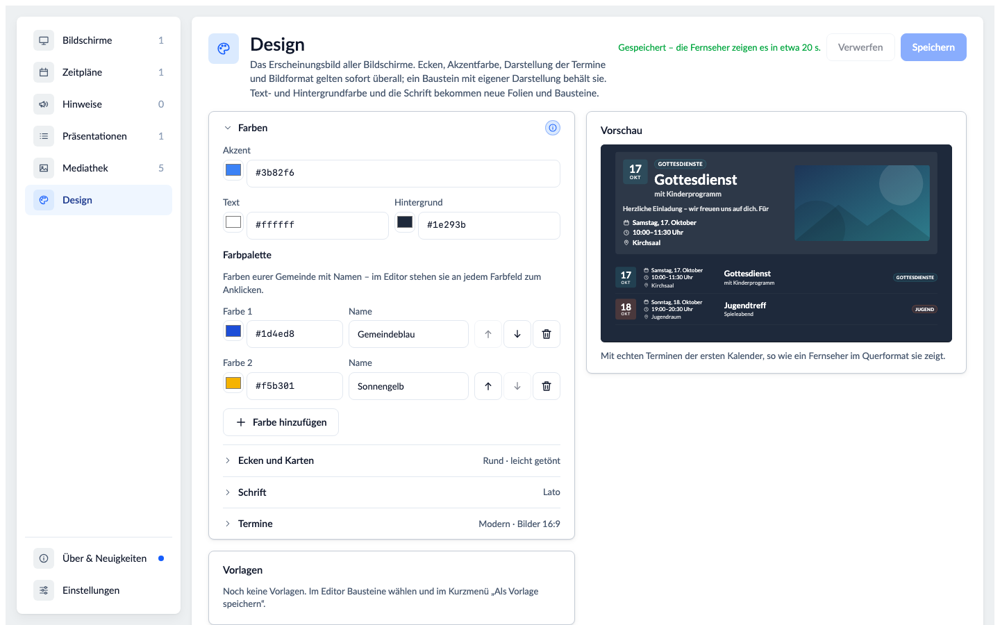

## Verlauf

Wer hat wann was geändert? Die Seite **„Verlauf"** in der Seitenleiste listet es auf, neueste zuerst: eine Zeile je Vorgang,
etwa „„Foyer" veröffentlicht: 2 Folien geändert, 1 neu", dazu Zeitpunkt, Person und Bereich. Festgehalten werden das
Veröffentlichen, Anlegen, Kopieren und Löschen von Präsentationen, Zeitpläne, Bildschirme, Hinweisbänder, das Design,
Vorlagen, Medien und die Einstellungen des Moduls – nicht die Entwürfe, die der Designer alle paar Sekunden sichert. Die
Liste lässt sich nach **Person** und nach **Bereich** eingrenzen. Im Editor führt „…" → **„Verlauf dieser Präsentation"**
zur gleichen Liste, begrenzt auf diese eine Präsentation.

Der Verlauf reicht **30 Tage** zurück; ältere Einträge werden beim Öffnen der Seite aufgeräumt. Alle Gestalter dürfen ihn
lesen, ändern oder löschen können sie Einträge nicht. **Nicht fälschungssicher:** ChurchTools merkt sich zu einem Eintrag
keinen Urheber, den Namen trägt der Designer ein. Der Verlauf hilft beim Nachfragen, er ist kein Beweis. Er beginnt, sobald
ein Administrator nach der Aktualisierung die Einrichtung öffnet; vorher sagt die Seite das.

## Am Handy und auf dem Tablet

Der Designer ist für den Finger gebaut. Am Handy steht die Folie mittig, unten die **Folienzeile** („Folie 2 von 5",
„+ Baustein", „⋯"); „Folie 2 von 5" öffnet die Folien als Bildchen zum Wählen, Hinzufügen und Umsortieren. Wer einen
Baustein antippt, bekommt darüber die **Zeile des Bausteins** mit denselben Feldern wie im Kurzmenü; „⋯ → Alle
Einstellungen" zieht das große Blatt hoch. Die Folie bleibt dabei ganz im Blick und springt nicht.

**Tippen, dann ziehen:** Ein Wisch über einen nicht gewählten Baustein scrollt die Seite – auch eine bildfüllende
Fläche fängt den Finger nicht. Erst ein gewählter Baustein lässt sich verschieben und an den Griffen skalieren; die
Griffe sind klein zu sehen, aber groß zu treffen. **Zwei Finger zoomen** die Folie bis 400 %; gezoomt verschiebt ein
Wisch die Fläche, und erst nach kurzem Halten hebt sich der Baustein an. „Ganze Folie" setzt zurück. Doppeltippen
schreibt auf einen Text oder öffnet den Inhalt, langes Drücken öffnet „⋯" (auf der leeren Fläche „Einfügen"). Beim
Schreiben zoomt der Editor, bis die Schrift lesbar ist, und hält den Text über der Bildschirmtastatur. Mehrere
Bausteine wählt man über „⋯ → Mehrere auswählen", Verdecktes über „Bausteine dieser Folie".

Auf dem Tablet gibt es das Kurzmenü wie am Rechner; die Einstellungen öffnen hochkant als Blatt, quer als Spalte
daneben. Am Rechner lassen sich Folien und Einstellungen einklappen.

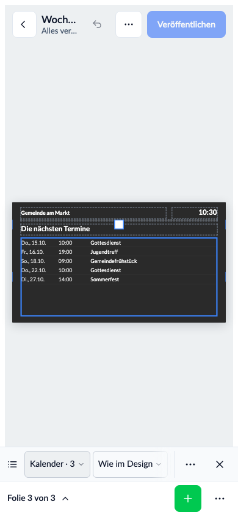

## Am Fernseher

Ohne Bild, weil es dort nichts zu bedienen gibt: Der Fernseher meldet sich über seine Adresse selbst an, holt
Änderungen in etwa 20 Sekunden, hält Daten und Bilder auf dem Gerät, zeigt bei einem Netzausfall den letzten Stand
und lädt jede Nacht neu. Er braucht weder Tastatur noch Maus.
