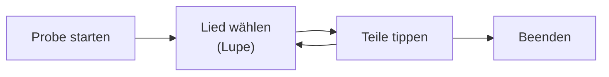

# Für Musiker – das Liedblatt vom Handy steuern

Auf dem Bildschirm vor der Band steht der Liedtext mit den Akkorden. Mit dem Handy wählst du, welcher Teil gerade zu sehen
ist – Strophe, Refrain, Bridge. Du brauchst nichts zu installieren.

## Was du brauchst

- Ein **ChurchTools-Konto**, mit dem du dich am Handy anmelden kannst.
- Du bist in der **Bandgruppe** deiner Gemeinde. Dann bekommst du die Rechte von selbst – nicht sofort, sondern beim
  nächsten Abgleich von ChurchTools. Klappt es nach einem Tag noch nicht: kurz beim ChurchTools-Admin melden.

## Die Seite öffnen

So kommst du hin – einer der drei Wege reicht:

- In ChurchTools im Menü auf **„Infoscreen Designer"** tippen.
- Die Adresse öffnen, die du vom Admin bekommen hast (sie endet auf `/steuerung`). **Tipp:** als Lesezeichen oder auf dem
  Home-Bildschirm ablegen.
- In der Probe zeigt der Bildschirm einen **QR-Code**, solange noch kein Lied gewählt ist – mit der Kamera scannen.

Solange die Seite offen ist, geht das Handy nicht in den Ruhezustand.

## Die Seite auf einen Blick

Die Seite hat drei Teile:

1. **Oben – der Bildschirm.** Links der Pfeil zurück zu ChurchTools, daneben der **Name des Bildschirms**. Gibt es mehrere
   Bildschirme, tippst du auf den Namen (mit dem kleinen Pfeil) und wählst einen anderen. Darunter ein farbiges **Band**
   sagt, was der Bildschirm gerade zeigt: grün **Gottesdienst**, gelb **Probe**, lila **Präsentation**, grau **Zeitplan**.
2. **Mitte – das Lied.** Alle Teile als Knöpfe; der blaue läuft gerade. Antippen, und der Bildschirm springt dorthin.
3. **Unten – Zurück und Vor.** Auf „Vor" steht klein, was als Nächstes kommt.

**Wichtig:** Alle Bildschirme zeigen dasselbe. Tippt jemand anderes in der Band, siehst du das auch auf deinem Handy.

## Im Gottesdienst

Das Lied kommt aus dem Ablaufplan – du musst nichts auswählen.

- **Teil antippen** oder mit **Vor** und **Zurück** weiterschalten.
- Am Ende eines Liedes bleibt **Vor** stehen (grau). Das nächste Lied wählst du mit **„Danach: …"** unter dem Lied.
- **„Alle Lieder"** klappt die Liste aller Lieder des Gottesdienstes auf – falls ihr spontan ein anderes spielt.

## In der Probe

1. Im Band oben **„Probe starten ›"** tippen, die Dauer wählen (1 bis 3 Stunden) und bestätigen. Während eines
   Gottesdienstes gibt es den Knopf nicht – so kann niemand den Bildschirm aus Versehen umschalten.
   Der Bildschirm braucht dann **einen kurzen Moment** – solange dreht sich ein Kreis mit „Wechselt zur Probe …".
2. Mit der **Lupe** ein Lied suchen und antippen. Hat es mehrere Arrangements, wählst du darunter das richtige.
3. Teile antippen oder mit **Vor** und **Zurück** schalten – wie im Gottesdienst. Für das nächste Lied wieder die Lupe.
4. Länger proben: das Band antippen, dann **„+1 Std"** oder **„+2 Std"**. Fertig: **„Beenden"** – der Bildschirm zeigt danach wieder sein
   normales Programm.

Beginnt laut Plan ein Gottesdienst, endet die Probe von selbst. **„Lied beenden"** (unten in der Suche) nimmt das Lied
vom Bildschirm, dann steht dort wieder der QR-Code.

## Präsentation per Klick

Läuft auf dem Bildschirm eine Präsentation, die ihr von Hand weiterschaltet, siehst du in der Mitte die Liste der
Folien. Folie antippen oder **Vor**/**Zurück**. **„Schwarz"** macht den Bildschirm dunkel, ein weiterer Tipp holt das
Bild zurück. Steht auf einer Folie ein Lied, schaltest du dessen Teile wie gewohnt; **„Nächste Folie: …"** unter dem
Lied führt weiter.

## Mit einem Presenter statt Tippen

Ein **Bluetooth-Presenter** (die kleine Fernbedienung für Präsentationen) funktioniert auch: mit dem Handy koppeln, die
Seite offen lassen. Die Taste nach vorn wirkt wie **Vor**, die Taste zurück wie **Zurück**. Das Handy muss dabei
entsperrt sein.

## Wenn etwas nicht klappt

| Was du siehst | Was du tun kannst |
| --- | --- |
| „Reagiert nicht – ist er an?" | Ist der Bildschirm eingeschaltet und im Netz? Sonst dem Technikteam Bescheid geben. |
| „Der Bildschirm meldet sich nicht" | Wie oben – das Handy erreicht ihn gerade nicht. |
| „Nicht gespeichert – bitte noch einmal tippen" | Kurz keine Verbindung. Noch einmal tippen. |
| „ChurchTools ist gerade nicht erreichbar" | Internet am Handy prüfen (WLAN oder mobile Daten). |
| Kein „Probe starten" im Band | Dieser Bildschirm ist nicht für Proben freigegeben – beim Admin fragen. |
| „Zu diesem Arrangement gibt es keinen Liedtext" | Zum Lied fehlt in ChurchTools die Datei mit dem Text. Wer die Lieder pflegt, kann sie ergänzen – oder ein anderes Arrangement wählen. |
| „Die Steuerung ist nicht eingerichtet, oder dir fehlt das Recht dafür" | Du bist (noch) nicht in der Bandgruppe, oder der Abgleich steht noch aus – beim Admin melden. |

Mehr zur Einrichtung (für Admins): [Einrichtung – Musiker steuern das Liedblatt](Einrichtung.md#musiker-steuern-das-liedblatt).
