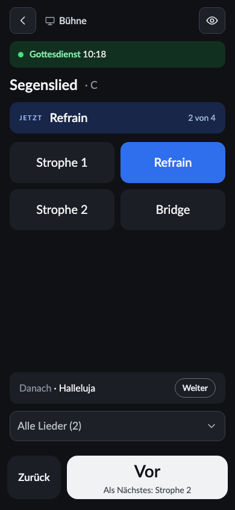
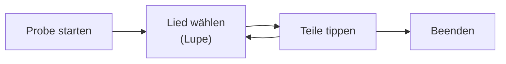
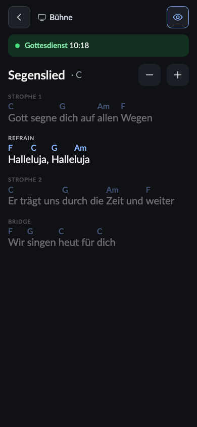
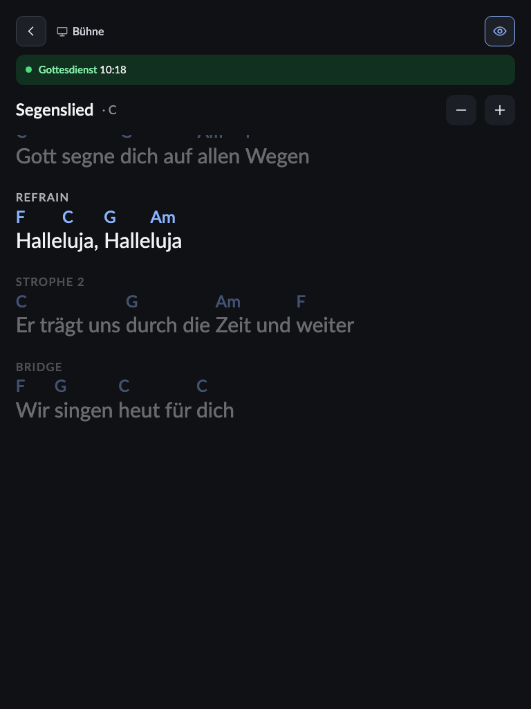

# Für Musiker – das Liedblatt vom Handy oder Tablet steuern und mitlesen

Auf dem Bildschirm vor der Band steht der Liedtext mit den Akkorden. Mit dem Handy oder Tablet wählst du, welcher Teil
gerade zu sehen ist – Strophe, Refrain, Bridge. Oder du liest Text und Akkorde direkt auf deinem Gerät mit, etwa auf dem
iPad am Notenständer. Du brauchst nichts zu installieren.

## Was du brauchst

- Ein **Handy oder Tablet** mit Browser und ein **ChurchTools-Konto**, mit dem du dich dort anmelden kannst.
- Du bist in der **Bandgruppe** deiner Gemeinde. Dann bekommst du die Rechte von selbst – nicht sofort, sondern beim
  nächsten Abgleich von ChurchTools. Klappt es nach einem Tag noch nicht: kurz beim ChurchTools-Admin melden.

## Die Seite öffnen

So kommst du hin – einer der drei Wege reicht:

- In ChurchTools im Menü auf **„Infoscreen Designer"** tippen.
- Die Adresse öffnen, die du vom Admin bekommen hast (sie endet auf `/steuerung`). **Tipp:** als Lesezeichen oder auf dem
  Home-Bildschirm ablegen.
- In der Probe zeigt der Bildschirm einen **QR-Code**, solange noch kein Lied gewählt ist – mit der Kamera scannen.

Solange die Seite offen ist, geht das Gerät nicht in den Ruhezustand – auch nicht das Tablet am Notenständer.

## Die Seite auf einen Blick

Die Seite hat drei Teile:

1. **Oben – der Bildschirm.** Links der Pfeil zurück zu ChurchTools, daneben der **Name des Bildschirms** mit dem kleinen
   Fernseher davor. Gibt es mehrere Bildschirme, tippst du auf den Namen (mit dem kleinen Pfeil) und wählst einen anderen.
   Rechts das **Auge** für den [Lesemodus](#mitlesen--der-lesemodus). Darunter sagt ein farbiges **Band**, was der Bildschirm
   gerade zeigt: grün **Gottesdienst**, gelb **Probe**, lila **Präsentation**, grau **Zeitplan**.
2. **Mitte – das Lied.** Die blaue **„Jetzt“-Zeile** sagt, welcher Teil gerade läuft („Refrain · 3 von 5“). Darunter alle Teile als große Kacheln; die blaue läuft gerade. Antippen, und der Bildschirm springt dorthin. Bei einer Präsentation stehen hier stattdessen die Folien als Zeilen.
3. **Unten – Zurück und Vor.** Links das schmale **Zurück**, rechts das große helle **Vor**; darauf steht klein „Als Nächstes: …".

**Wichtig:** Alle Bildschirme zeigen dasselbe. Tippt jemand anderes in der Band, siehst du das auch auf deinem Handy.

## Im Gottesdienst

Das Lied kommt aus dem Ablaufplan – du musst nichts auswählen.

- **Teil antippen** oder mit **Vor** und **Zurück** weiterschalten.
- Am Ende eines Liedes bleibt **Vor** stehen (grau). Das nächste Lied wählst du mit **„Weiter"** in der Zeile
  **„Danach · …"** unten.
- **„Alle Lieder"** klappt die Liste aller Lieder des Gottesdienstes auf – falls ihr spontan ein anderes spielt.

## In der Probe

1. Im Band oben **„Probe starten"** tippen, die Dauer wählen (1 bis 3 Stunden) und bestätigen. Während eines
   Gottesdienstes gibt es den Knopf nicht – so kann niemand den Bildschirm aus Versehen umschalten.
   Der Bildschirm braucht dann **einen kurzen Moment** – solange dreht sich ein Kreis mit „Wechselt zur Probe …".
2. Mit der **Lupe** ein Lied suchen und antippen. Hat es mehrere Arrangements, wählst du darunter das richtige – sie
   stehen dort kurz mit ihrer Tonart, etwa „Standard · G" oder „Neu · A".
3. Teile antippen oder mit **Vor** und **Zurück** schalten – wie im Gottesdienst. Für das nächste Lied wieder die Lupe.
4. Länger proben: im Band **„Ändern"** tippen, dann **„+1 Std"** oder **„+2 Std"**. Fertig: **„Beenden"** – der Bildschirm zeigt danach wieder sein
   normales Programm.

Beginnt laut Plan ein Gottesdienst, endet die Probe von selbst. **„Lied beenden"** nimmt das Lied vom Bildschirm, dann
steht dort wieder der QR-Code. Der Knopf steht am letzten Teil eines Liedes unter den Kacheln, mitten im Lied findest du
ihn unten in der Suche (Lupe).

## Mitlesen – der Lesemodus

Du möchtest Text und Akkorde vor dir haben, statt zum Bildschirm zu schauen? Tippe oben rechts auf das **Auge**. Dann
zeigt dein Handy oder Tablet das ganze Lied:

- **Es läuft mit.** Der Teil, der gerade dran ist, steht hell oben; die anderen Teile sind blass. Schaltet jemand weiter,
  rollt die Seite von selbst zum nächsten Teil.
- **Selbst blättern geht.** Rollst du von Hand weg, erscheint unten **„Zum laufenden Teil"** – ein Tipp, und du bist
  wieder dort, wo die Band ist.
- **Schrift größer oder kleiner** mit **−** und **+** neben dem Liedtitel. Jedes Gerät merkt sich seine Größe.
- **Nur lesen.** Im Lesemodus kannst du nichts umschalten – keine Kacheln, kein „Vor", kein „Ändern". So schaltet ein
  Tablet am Notenständer nie aus Versehen. Zum Steuern tippst du wieder auf das Auge.
- Das Auge gibt es, solange ein Lied läuft (Gottesdienst oder Probe). Dein Gerät merkt sich, ob du zuletzt gelesen hast.

Auf dem **Tablet** steht der Text größer und mit mehr Rand – so sieht es auf einem iPad hochkant aus:

Zum Mitlesen braucht das Lied in ChurchTools eine **Datei mit Text** – am besten mit Akkorden (ChordPro). Gibt es nur ein
PDF, steht dort „Für dieses Lied gibt es keinen Text zum Mitlesen". Noten zeigt der Lesemodus nicht.

## Präsentation per Klick

Läuft auf dem Bildschirm eine Präsentation, die ihr von Hand weiterschaltet, siehst du in der Mitte die Liste der
Folien. Folie antippen oder **Vor**/**Zurück**. Ist der Bildschirm gerade schwarz (das geht nur am Gerät selbst, mit dem Presenter), steht in der „Jetzt"-Zeile **„Schwarz"**; ein Tipp auf **Vor** holt das
Bild zurück. Steht auf einer Folie ein Lied, schaltest du dessen Teile wie gewohnt; **„Nächste Folie: …"** unter dem
Lied führt weiter.

## Mit einem Presenter statt Tippen

Ein **Bluetooth-Presenter** (die kleine Fernbedienung für Präsentationen) funktioniert auch: mit dem Handy koppeln, die
Seite offen lassen. Die Taste nach vorn wirkt wie **Vor**, die Taste zurück wie **Zurück**. Das Handy muss dabei
entsperrt sein.

## Wenn etwas nicht klappt

| Was du siehst | Was du tun kannst |
| --- | --- |
| „Reagiert nicht – ist er an?" | Ist der Bildschirm eingeschaltet und im Netz? Sonst dem Technikteam Bescheid geben. |
| „Der Bildschirm meldet sich nicht" | Wie oben – das Handy erreicht ihn gerade nicht. |
| „Nicht gespeichert – bitte noch einmal tippen" | Kurz keine Verbindung. Noch einmal tippen. |
| „ChurchTools ist gerade nicht erreichbar" | Internet am Handy prüfen (WLAN oder mobile Daten). |
| Kein „Probe starten" im Band | Dieser Bildschirm ist nicht für Proben freigegeben – beim Admin fragen. |
| Kein Auge oben rechts | Das Auge gibt es nur, während ein Lied läuft – im Gottesdienst oder in der Probe. |
| „Für dieses Lied gibt es keinen Text zum Mitlesen" | Zum Lied liegt in ChurchTools nur ein PDF oder gar keine Datei. Wer die Lieder pflegt, kann eine Datei mit Text und Akkorden ergänzen. |
| „Zu diesem Arrangement gibt es keinen Liedtext" | Zum Lied fehlt in ChurchTools die Datei mit dem Text. Wer die Lieder pflegt, kann sie ergänzen – oder ein anderes Arrangement wählen. |
| „Die Steuerung ist nicht eingerichtet, oder dir fehlt das Recht dafür" | Du bist (noch) nicht in der Bandgruppe, oder der Abgleich steht noch aus – beim Admin melden. |

Mehr zur Einrichtung (für Admins): [Einrichtung – Musiker steuern das Liedblatt](Einrichtung.md#musiker-steuern-das-liedblatt).
