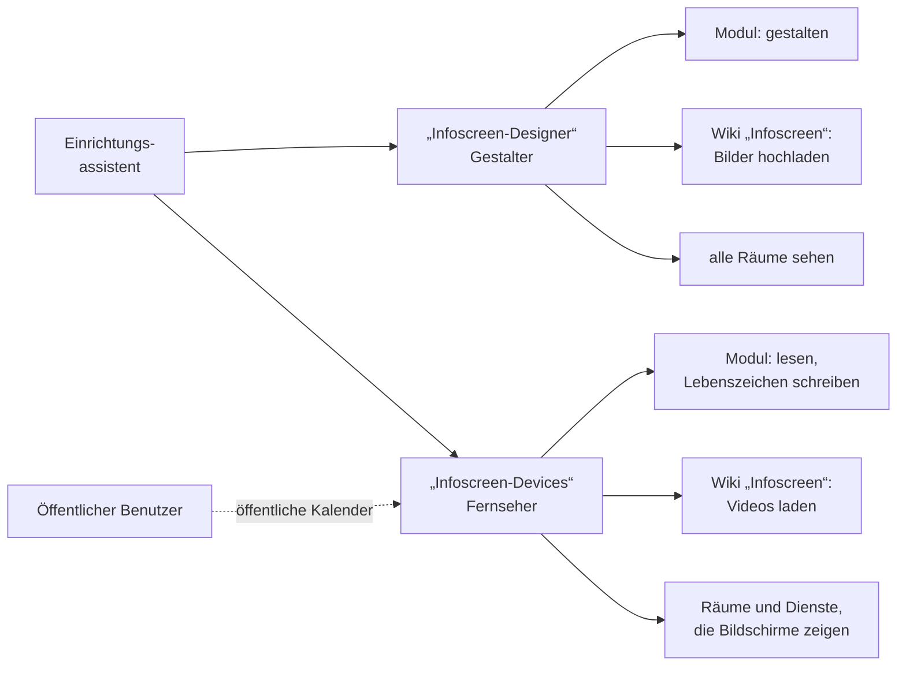

# Rechte im Infoscreen Designer – wer braucht was?

Die Übersicht für ChurchTools-Administratoren: welche Rolle welche Rechte braucht und woher sie kommen. Wie man
einrichtet, steht in der [Einrichtungsanleitung](Einrichtung.md).

## Die drei Rollen auf einen Blick

| Rolle | Wer | Darf |
| --- | --- | --- |
| **Administrator** | ChurchTools-Admins | Extension installieren, **Einstellungen** öffnen, **Bildschirme anlegen, einstellen, löschen** |
| **Gestalter** | Mitglieder von **„Infoscreen-Designer"** | Folien, Präsentationen, Zeitpläne und Bilder gestalten – nicht die Bildschirme selbst und nicht die Einstellungen |
| **Gerät** | Konten der Fernseher in **„Infoscreen-Devices"** | nur lesen; schreiben nur sein Lebenszeichen |

**Rechte vergibt niemand von Hand an Personen.** Der Assistent gibt sie den beiden Gruppen
([Einrichtung, Schritt 4](Einrichtung.md#4-gruppen-und-rechte-anlegen-lassen)); du nimmst danach nur noch Personen auf
oder heraus. Einzige Ausnahme sind die Modulrechte der Administratoren
([Schritt 2](Einrichtung.md#2-dir-selbst-die-modulrechte-geben)). Die Tabellen unten sind zum Nachschlagen und Prüfen.

**Gruppen und Beiträge brauchen kein eigenes Recht** – die Bausteine zeigen nur, was ChurchTools ohnehin öffentlich
zeigt.

## Rechte je Rolle

**Kategorien** sind die Ablagen des Moduls: **Screens**, **Playlists**, **Slides**, **Medien**, **Einstellungen**,
**Entwürfe** und **Status** (Lebenszeichen der Fernseher).

### Modul „Infoscreen Designer"

| Im Assistenten | In der Rechteverwaltung (API) | Administrator | Gestalter | Gerät |
| --- | --- | --- | --- | --- |
| „Infoscreen Designer" sehen | `view` | ✓ | ✓ | ✓ |
| Kategorien sehen | `view custom category` | alle | alle | alle außer Entwürfe |
| – | `create custom category` | ✓ ¹ | – | – |
| Daten in Kategorie sehen | `view custom data` | alle | alle | alle außer Entwürfe |
| Daten in Kategorie erstellen | `create custom data` | alle | Playlists, Slides, Medien, Entwürfe | Status |
| Daten in Kategorie bearbeiten | `edit custom data` | alle | Playlists, Slides, Medien, Entwürfe | Status |
| Daten in Kategorie löschen | `delete custom data` | alle | Playlists, Slides, Medien, Entwürfe | – |
| – | `edit custom category`, `delete custom category` | – | – | – |

¹ Nur damit der Designer beim ersten Öffnen seine Kategorien anlegen kann.

Weil das Gerät die Entwürfe nicht sieht, kann ein Fernseher **nie einen Entwurf zeigen**. Wer die Adresse eines
Fernsehers kennt, kann höchstens dessen Lebenszeichen ändern.

### Wiki – für die Mediathek

| Im Assistenten | In der Rechteverwaltung | Administrator | Gestalter | Gerät |
| --- | --- | --- | --- | --- |
| „Wiki" sehen | „Wiki" sehen (`view`, 501) | ✓ | ✓ | – |
| Wiki-Bereich „Infoscreen" sehen | Einzelne Wiki-Kategorien sehen (`view category`, 502) | ✓ | ✓ | ✓ ² |
| Wiki-Bereich „Infoscreen" bearbeiten | Einzelne Wiki-Kategorien bearbeiten (`edit category`, 503) | ✓ | ✓ | – |

² Für Videos; Bilder kommen ohne Anmeldung.

**Das Bearbeiten eng vergeben:** Wer es hat, kann im Wiki Bilder löschen, an der Warnung der Mediathek vorbei.

### Kalender – für Termine auf den Bildschirmen

| Im Assistenten | In der Rechteverwaltung | Administrator | Gestalter | Gerät |
| --- | --- | --- | --- | --- |
| Einzelnen Kalender sehen | Einzelnen Kalender sehen (`view category`, 403) | für die Vorschau | freigegebene interne Kalender | freigegebene interne Kalender ³ |

³ **Öffentliche Kalender** sieht das Gerät ohne eigenes Recht, über den öffentlichen Benutzer (Berechtigungen →
Benutzer → „Öffentlicher Benutzer" → Kalender). Das Recht gibt der Assistent nur für **interne Kalender, die ein
Administrator für Bildschirme freigegeben hat** – über die Adresse des Fernsehers sind sie dann ganz lesbar.

### Ressourcen – für die Raumbelegung

| Im Assistenten | In der Rechteverwaltung | Administrator | Gestalter | Gerät |
| --- | --- | --- | --- | --- |
| Ressource sehen | Ressource sehen (`view resource`, 205) | für die Vorschau | **alle Räume** | **jeden Raum, den ein Bildschirm zeigt** – alle Räume, sobald ein Termin-Baustein „Raum zeigen" an hat |

Nur Räume, nicht Gegenstände und Fahrzeuge.

### Events – für Dienste am Termin

| Im Assistenten | In der Rechteverwaltung | Administrator | Gestalter | Gerät |
| --- | --- | --- | --- | --- |
| Events von einzelnen Kalendern sehen | Events von einzelnen Kalendern sehen (`view events`, 306) | für die Vorschau | für die Vorschau | **jeden Kalender, dessen Termine Dienste zeigen** |

Das Gerät sieht damit nur zugesagte Dienste aus Dienstgruppen, die „Ohne Berechtigung einsehbar" sind.

### ChurchTools selbst – nur für Administratoren

| Bereich | Recht | Wofür |
| --- | --- | --- |
| Administration | „Erweiterungen verwalten" | Extension hochladen und aktualisieren |
| Administration | „Berechtigungen verwalten" | Einstellungen des Designers, der Assistent, „Rechte aktualisieren", Adressen für Fernseher |
| Gruppen | „Gruppen eines Gruppentyps erstellen" und „… sehen" für den gewählten Gruppentyp | „Gruppen und Rechte anlegen" |
| Gruppen | „Gruppen eines Gruppentyps löschen" für diesen Typ | „Automatische Einrichtung rückgängig machen" |
| Gruppen | „Gruppenmitgliedschaften … bearbeiten" für diesen Typ | Gestalter und Gerätekonten aufnehmen |
| Gruppen | statt der drei Zeilen oben: „Gruppen verwalten" | alles davon auf einmal |
| Wiki | „„Wiki" sehen" und „Stammdaten bearbeiten" | den Wiki-Bereich „Infoscreen" anlegen |
| Personen | „Personen erstellen" und „Personen bearbeiten" | das Gerätekonto anlegen |
| Administration | „Personen simulieren, Passwort ändern und Zugang sperren" | dem Gerätekonto ein Passwort setzen |
| Infoscreen Designer | die Modulrechte aus [Schritt 2](Einrichtung.md#2-dir-selbst-die-modulrechte-geben) | Bildschirme anlegen, einstellen, löschen |

Fehlt ein Recht, nennt es die Einstellungsseite. **„Berechtigungen verwalten" ist mächtig** – wer es hat, kann sich jedes
andere Recht selbst geben. Ein **Super-Admin** hat alles davon und braucht auch die Modulrechte nicht ausdrücklich.

## Was „Rechte aktualisieren" zurücknimmt

„Rechte aktualisieren" nimmt auch zurück, was kein Bildschirm mehr braucht – **nur an den Gruppen des Assistenten** und
nur an Kalendern und Räumen, die du selbst siehst. Vorher zeigt eine Vorschau, was wegfällt.

| Im Assistenten | In der Rechteverwaltung (API) | Gruppe | Wann es wegfällt |
| --- | --- | --- | --- |
| Einzelnen Kalender sehen | Einzelnen Kalender sehen (`view category`, 403) | Gerät, Gestalter | Der Kalender ist nicht mehr für Bildschirme freigegeben |
| Events von einzelnen Kalendern sehen | Events von einzelnen Kalendern sehen (`view events`, 306) | Gerät | Kein Baustein zeigt mehr Dienste dieses Kalenders |
| Ressource sehen | Ressource sehen (`view resource`, 205) | Gerät, Gestalter | Der Raum wird nicht mehr gebraucht |
| Anlegen von Bildschirmen und Einstellungen | `create custom data` | Gestalter, Gerät | immer – das ist Sache der Administratoren |
| Bearbeiten von Bildschirmen und Einstellungen | `edit custom data` | Gestalter, Gerät | immer |
| Löschen von Bildschirmen und Einstellungen | `delete custom data` | Gestalter, Gerät | immer |

**Deshalb an den Gruppen des Assistenten nichts von Hand ergänzen** – wer mehr vergeben will, nimmt eine eigene
Gruppe. Entzogene Rechte wirken bei ChurchTools noch bis zu einer Dreiviertelstunde nach.

## Was brauche ich für …?

| Ich will … | Rolle | Fehlt es, dann … |
| --- | --- | --- |
| den Menüpunkt „Infoscreen Designer" sehen | alle | „Infoscreen Designer" sehen |
| Folien gestalten und speichern | Gestalter | Mitglied in „Infoscreen-Designer" werden |
| Bilder und Videos hochladen | Gestalter | Mitglied in „Infoscreen-Designer" werden |
| einen Bildschirm anlegen, umbenennen, löschen | Administrator | Modulrechte für **Screens** ([Schritt 2](Einrichtung.md#2-dir-selbst-die-modulrechte-geben)) |
| dass der Fernseher Termine zeigt | – | der Kalender muss **öffentlich** oder für Bildschirme freigegeben sein |
| dass der Fernseher Räume oder Dienste zeigt | Administrator | „Rechte aktualisieren" |

Die Startseite des Designers nennt fehlende Rechte selbst.

## Woher die Rechte kommen

- **Über die Gruppen des Assistenten** – alle Rollen einer Gruppe bekommen dieselben Rechte. Nach einem Update einmal
  **„Rechte aktualisieren"**.
- **Rechte addieren sich.** Was der Personenstatus, der Gruppentyp oder eine andere Gruppe erlaubt, kommt dazu. Ein
  Gerätekonto bekommt deshalb einen Status mit wenig Rechten und gehört in **keine weitere Gruppe** – sonst darf jeder,
  der die Adresse des Fernsehers kennt, mehr. Die Prüfung in den Einstellungen warnt davor und nennt die Herkunft.
- **Gruppenrechte wirken nur, solange die Gruppe „aktiv" ist.**
