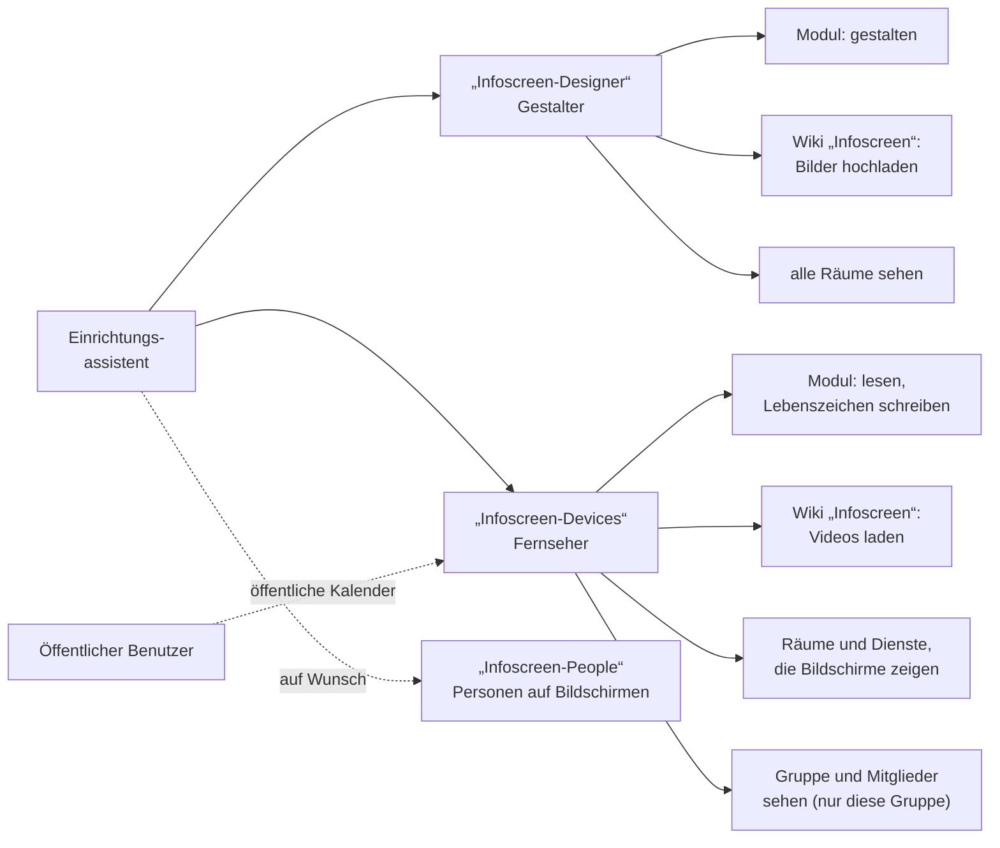

# Rechte im Infoscreen Designer – wer braucht was?

Die Übersicht für ChurchTools-Administratoren: welche Rolle welche Rechte braucht und woher sie kommen. Wie man
einrichtet, steht in der [Einrichtungsanleitung](Einrichtung.md).

## Die drei Rollen auf einen Blick

| Rolle | Wer | Darf |
| --- | --- | --- |
| **Administrator** | ChurchTools-Admins | Extension installieren, **Einstellungen** öffnen, **Bildschirme anlegen, einstellen, löschen** |
| **Gestalter** | Mitglieder von **„Infoscreen-Designer"** | Folien, Präsentationen, Zeitpläne und Bilder gestalten – nicht die Bildschirme selbst und nicht die Einstellungen |
| **Gerät** | Konten der Fernseher in **„Infoscreen-Devices"** | nur lesen; schreiben nur sein Lebenszeichen |

Auf Wunsch kommt die Gruppe **„Infoscreen-People"** dazu: Wer dort Mitglied ist, darf im Baustein „Personen" auf den Bildschirmen erscheinen.
Sie ist keine Rolle mit eigenen Rechten, sondern die Freigabe von Personen – wie jede andere freigegebene Gruppe, nur dass die Geräte
dort automatisch Mitglied werden ([unten](#personen--für-den-baustein-personen)). Der Assistent legt sie nicht von selbst an.

**Rechte vergibt niemand von Hand an Personen.** Der Assistent gibt sie den beiden Gruppen
([Einrichtung, Schritt 4](Einrichtung.md#4-gruppen-und-rechte-anlegen-lassen)); du nimmst danach nur noch Personen auf
oder heraus. Einzige Ausnahme sind die Modulrechte der Administratoren
([Schritt 2](Einrichtung.md#2-dir-selbst-die-modulrechte-geben)). Die Tabellen unten sind zum Nachschlagen und Prüfen.

**Gruppen und Beiträge brauchen kein eigenes Recht** – die Bausteine zeigen nur, was ChurchTools ohnehin öffentlich
zeigt.

## Rechte je Rolle

**Kategorien** sind die Ablagen des Moduls: **Screens**, **Playlists**, **Slides**, **Medien**, **Einstellungen**,
**Entwürfe** und **Status** (Lebenszeichen der Fernseher).

### Modul „Infoscreen Designer"

| Im Assistenten | In der Rechteverwaltung (API) | Administrator | Gestalter | Gerät |
| --- | --- | --- | --- | --- |
| „Infoscreen Designer" sehen | `view` | ✓ | ✓ | ✓ |
| Kategorien sehen | `view custom category` | alle | alle | alle außer Entwürfe |
| – | `create custom category` | ✓ ¹ | – | – |
| Daten in Kategorie sehen | `view custom data` | alle | alle | alle außer Entwürfe |
| Daten in Kategorie erstellen | `create custom data` | alle | Playlists, Slides, Medien, Entwürfe | Status |
| Daten in Kategorie bearbeiten | `edit custom data` | alle | Playlists, Slides, Medien, Entwürfe | Status |
| Daten in Kategorie löschen | `delete custom data` | alle | Playlists, Slides, Medien, Entwürfe | – |
| – | `edit custom category`, `delete custom category` | – | – | – |

¹ Nur damit der Designer beim ersten Öffnen seine Kategorien anlegen kann.

Weil das Gerät die Entwürfe nicht sieht, kann ein Fernseher **nie einen Entwurf zeigen**. Wer die Adresse eines
Fernsehers kennt, kann höchstens dessen Lebenszeichen ändern.

### Wiki – für die Mediathek

| Im Assistenten | In der Rechteverwaltung | Administrator | Gestalter | Gerät |
| --- | --- | --- | --- | --- |
| „Wiki" sehen | „Wiki" sehen (`view`, 501) | ✓ | ✓ | – |
| Wiki-Bereich „Infoscreen" sehen | Einzelne Wiki-Kategorien sehen (`view category`, 502) | ✓ | ✓ | ✓ ² |
| Wiki-Bereich „Infoscreen" bearbeiten | Einzelne Wiki-Kategorien bearbeiten (`edit category`, 503) | ✓ | ✓ | – |

² Für Videos; Bilder kommen ohne Anmeldung.

**Das Bearbeiten eng vergeben:** Wer es hat, kann im Wiki Bilder löschen, an der Warnung der Mediathek vorbei.

### Kalender – für Termine auf den Bildschirmen

| Im Assistenten | In der Rechteverwaltung | Administrator | Gestalter | Gerät |
| --- | --- | --- | --- | --- |
| Einzelnen Kalender sehen | Einzelnen Kalender sehen (`view category`, 403) | für die Vorschau | freigegebene interne Kalender | freigegebene interne Kalender ³ |

³ **Öffentliche Kalender** sieht das Gerät ohne eigenes Recht, über den öffentlichen Benutzer (Berechtigungen →
Benutzer → „Öffentlicher Benutzer" → Kalender). Das Recht gibt der Assistent nur für **interne Kalender, die ein
Administrator für Bildschirme freigegeben hat** – über die Adresse des Fernsehers sind sie dann ganz lesbar.

### Ressourcen – für die Raumbelegung

| Im Assistenten | In der Rechteverwaltung | Administrator | Gestalter | Gerät |
| --- | --- | --- | --- | --- |
| Ressource sehen | Ressource sehen (`view resource`, 205) | für die Vorschau | **alle Räume** | **jeden Raum, den ein Bildschirm zeigt** – alle Räume, sobald ein Termin-Baustein „Raum zeigen" an hat |

Nur Räume, nicht Gegenstände und Fahrzeuge.

### Events – für Dienste am Termin

| Im Assistenten | In der Rechteverwaltung | Administrator | Gestalter | Gerät |
| --- | --- | --- | --- | --- |
| Events von einzelnen Kalendern sehen | Events von einzelnen Kalendern sehen (`view events`, 306) | für die Vorschau | für die Vorschau | **jeden Kalender, dessen Termine Dienste zeigen** |

Das Gerät sieht damit nur zugesagte Dienste aus Dienstgruppen, die „Ohne Berechtigung einsehbar" sind.

### Personen – für den Baustein „Personen"

Der Baustein zeigt Mitglieder **freigegebener vorhandener Gruppen** (unten) oder die Mitglieder einer eigenen Gruppe „Infoscreen-People", die sich **auf Wunsch** anlegen lässt (Einstellungen → Gruppen für „Personen"). Für diese eigene Gruppe liest das Gerät mit zwei Rechten und **nur** diese Gruppe. Das erste vergibt der Assistent beim Anlegen, das zweite der Administrator in ChurchTools; die Geräte werden dort automatisch Mitglied, daher gilt das zweite für alle Geräte mit einem Recht an der Standardrolle:

| Im Assistenten | In der Rechteverwaltung | Administrator | Gestalter | Gerät |
| --- | --- | --- | --- | --- |
| Gruppe „Infoscreen-People" inkl. ihrer Gruppenmitglieder sehen | Gruppe inkl. ihrer Gruppenmitglieder sehen (`1104`, global, für diese Gruppe) | für die Vorschau | für die Vorschau | **nur „Infoscreen-People"** – Name, Bild, Rolle |
| – (setzt der Administrator) | Gruppenmitgliedsfelder sehen (`10126`, gruppenintern, auf der Stufe der gewünschten Mitgliedsfelder) | – | – | an der **Standardrolle von „Infoscreen-People"**, in der die Geräte Mitglied sind |

| Freigegebene Gruppe inkl. ihrer Gruppenmitglieder sehen | Gruppe inkl. ihrer Gruppenmitglieder sehen (`1104`, global, je freigegebener Gruppe) | – | – | **nur die Gruppen, die ein Administrator unter „Gruppen für Personen" freigegeben hat** – Name, Bild, Rolle |

Das zweite Recht ist **gruppenintern** und gilt für alle, die diese Rolle haben; die Sicherheitsstufe begrenzt es auf
Mitgliedsfelder bis zu dieser Stufe. Die Stufen sind je Gemeinde frei (G73); der Infoscreen vergibt das Recht nicht und nimmt
es nicht zurück. Die Prüfung der Gerätegruppe weist darauf hin, wenn es fehlt, und warnt, wenn es auf eine Stufe zeigt, die es nicht gibt. „Gruppenmitglieder sehen" (`10101`) wird **nie** vergeben. „Personendaten sehen" (`125`) vergibt der
Assistent **nicht mehr**: Beide geben schon in der ersten Stufe die E-Mail-Adresse einer Person frei. Nur wenn ein Administrator
unter *Einstellungen → Gruppen für „Personen"* **Personenfelder** freischalten will, setzt er `125` selbst in ChurchTools (unten).
Die Prüfung der Gerätegruppe warnt vor allem anderen.

**Personenfelder:** ChurchTools gibt Personendaten einem Gerät nur als ganze Sicherheitsstufe frei, über „Personendaten sehen"
(`125`, global) mit der Stufe als Datenangabe (gemessen, Befunde.md G71). Die Stufen sind je Gemeinde frei, ihre Nummer ist ihre
Reihenfolge, und sie bauen aufeinander auf: Wer eine Stufe sieht, sieht alle mit kleinerer Nummer mit (G73). Der **Administrator** gibt
der Gerätegruppe `125` in ChurchTools auf der niedrigsten Stufe, in der die gewünschten Felder liegen; der Infoscreen vergibt es nicht
und nimmt es nicht zurück. Der Designer liest die Stufen und die Rechte der Geräte bei jedem Aufruf frisch und bietet nur Felder an,
die in dieser Reichweite liegen. Die Auswahl **je Feld** trifft der Infoscreen (Einstellungen, dann der Baustein), nicht ChurchTools:
Technisch kann das Gerät **alle Felder bis zu seiner Stufe** lesen, der Baustein zeigt nur die freigeschalteten. Ändert eine Gemeinde
in ChurchTools die Stufe eines Feldes, ändert sich damit, was das Gerät liest. Die Prüfung der Gerätegruppe zeigt den Hinweis
„Personenfelder freigeschaltet“ und warnt, wenn das Gerät höher sieht als die Felder brauchen, wenn Felder außerhalb seiner Reichweite
liegen und wenn `125` auf eine Stufe zeigt, die es nicht gibt (ChurchTools nimmt ein solches Recht ohne Fehlermeldung an).

**Freigegebene Gruppen:** Für eine vorhandene Gruppe, die du unter *Einstellungen → Gruppen für „Personen"* freigibst, setzt der
Assistent `1104` mit dieser Gruppen-id an den Rollen der **Gerätegruppe**. Die freigegebene Gruppe selbst fasst er nie an:
keine Mitgliedschaft, kein `10126`, keine Beitragseinstellung. Das geschieht schon beim **Speichern** der Seite; nimmst du
eine Freigabe zurück, fällt die Gruppen-id wieder aus `1104` heraus – nur die Ids, die vorher freigegeben waren; ein `1104`,
das du von Hand auf eine andere Gruppe vergeben hast, bleibt stehen. Gelingt der Rechte-Teil einmal nicht, bleibt die
Freigabe gespeichert, und „Rechte aktualisieren" trägt fehlende Rechte nach. **Mitgliedsfelder** einer freigegebenen Gruppe sieht das Gerät nur mit dem gruppeninternen Recht
`10126` auf der Stufe der gewünschten Felder – als Mitglied der Gruppe oder über eine Obergruppe: dort als vererbtes Recht der Rolle des Gerätekontos
unter „Berechtigung für die Untergruppen", mit mindestens einer Ebene (gemessen, Befunde.md G72). Nimmst du das
Gerätekonto von Hand in die Gruppe selbst auf, gibst du der Rolle des Kontos `10126`; das gilt dann für **alle** mit dieser Rolle in der Gruppe. Ohne das erscheinen Name, Bild und Rolle. Die Prüfung der Gerätegruppe zeigt das als Hinweis, nicht als Warnung.

**Beiträge** sind in „Infoscreen-Devices“ und „Infoscreen-People“ abgeschaltet: Der Gruppentyp „Merkmal“ gibt seinen Rollen
sonst „Beitrag in Gruppe schreiben“ (`10130`, `10131`, gruppenintern). Mit abgeschalteten Beiträgen lehnt ChurchTools das
Schreiben ab (`422`), Lesen von Mitgliedern und Feldern bleibt. Die Prüfung der Gerätegruppe warnt vor diesen
Beitragsrechten nur, solange die Beiträge noch eingeschaltet sind.

### ChurchTools selbst – nur für Administratoren

| Bereich | Recht | Wofür |
| --- | --- | --- |
| Administration | „Erweiterungen verwalten" | Extension hochladen und aktualisieren |
| Administration | „Berechtigungen verwalten" | Einstellungen des Designers, der Assistent, „Rechte aktualisieren", Adressen für Fernseher |
| Gruppen | „Gruppen eines Gruppentyps erstellen" und „… sehen" für den gewählten Gruppentyp | „Gruppen und Rechte anlegen" |
| Gruppen | „Gruppen eines Gruppentyps löschen" für diesen Typ | „Automatische Einrichtung rückgängig machen" |
| Gruppen | „Gruppenmitgliedschaften … bearbeiten" für diesen Typ | Gestalter und Gerätekonten aufnehmen |
| Gruppen | statt der drei Zeilen oben: „Gruppen verwalten" | alles davon auf einmal |
| Wiki | „„Wiki" sehen" und „Stammdaten bearbeiten" | den Wiki-Bereich „Infoscreen" anlegen |
| Personen | „Personen erstellen" und „Personen bearbeiten" | das Gerätekonto anlegen |
| Administration | „Personen simulieren, Passwort ändern und Zugang sperren" | dem Gerätekonto ein Passwort setzen |
| Infoscreen Designer | die Modulrechte aus [Schritt 2](Einrichtung.md#2-dir-selbst-die-modulrechte-geben) | Bildschirme anlegen, einstellen, löschen |

Fehlt ein Recht, nennt es die Einstellungsseite. **„Berechtigungen verwalten" ist mächtig** – wer es hat, kann sich jedes
andere Recht selbst geben. Ein **Super-Admin** hat alles davon und braucht auch die Modulrechte nicht ausdrücklich.

## Was „Rechte aktualisieren" zurücknimmt

„Rechte aktualisieren" nimmt auch zurück, was kein Bildschirm mehr braucht – **nur an den Gruppen des Assistenten** und
nur an Kalendern und Räumen, die du selbst siehst (das `1104` für Gruppen nimmt schon das Speichern der Freigabeseite zurück). Vorher zeigt eine Vorschau, was wegfällt.

| Im Assistenten | In der Rechteverwaltung (API) | Gruppe | Wann es wegfällt |
| --- | --- | --- | --- |
| Einzelnen Kalender sehen | Einzelnen Kalender sehen (`view category`, 403) | Gerät, Gestalter | Der Kalender ist nicht mehr für Bildschirme freigegeben |
| Events von einzelnen Kalendern sehen | Events von einzelnen Kalendern sehen (`view events`, 306) | Gerät | Kein Baustein zeigt mehr Dienste dieses Kalenders |
| Ressource sehen | Ressource sehen (`view resource`, 205) | Gerät, Gestalter | Der Raum wird nicht mehr gebraucht |
| Freigegebene Gruppe inkl. ihrer Gruppenmitglieder sehen | Gruppe inkl. ihrer Gruppenmitglieder sehen (`1104`) | Gerät | Die Freigabe wird beim Speichern der Seite „Gruppen für Personen" zurückgenommen („Infoscreen-People" und ein von Hand vergebenes `1104` bleiben) |
| Anlegen von Bildschirmen und Einstellungen | `create custom data` | Gestalter, Gerät | immer – das ist Sache der Administratoren |
| Bearbeiten von Bildschirmen und Einstellungen | `edit custom data` | Gestalter, Gerät | immer |
| Löschen von Bildschirmen und Einstellungen | `delete custom data` | Gestalter, Gerät | immer |

**Deshalb an den Gruppen des Assistenten nichts von Hand ergänzen** – wer mehr vergeben will, nimmt eine eigene
Gruppe. Entzogene Rechte wirken bei ChurchTools noch bis zu einer Dreiviertelstunde nach.

## Was brauche ich für …?

| Ich will … | Rolle | Fehlt es, dann … |
| --- | --- | --- |
| den Menüpunkt „Infoscreen Designer" sehen | alle | „Infoscreen Designer" sehen |
| Folien gestalten und speichern | Gestalter | Mitglied in „Infoscreen-Designer" werden |
| Bilder und Videos hochladen | Gestalter | Mitglied in „Infoscreen-Designer" werden |
| einen Bildschirm anlegen, umbenennen, löschen | Administrator | Modulrechte für **Screens** ([Schritt 2](Einrichtung.md#2-dir-selbst-die-modulrechte-geben)) |
| dass der Fernseher Termine zeigt | – | der Kalender muss **öffentlich** oder für Bildschirme freigegeben sein |
| dass der Fernseher Räume oder Dienste zeigt | Administrator | „Rechte aktualisieren" |
| dass der Fernseher Personen zeigt | Administrator | Gerät in „Infoscreen-People" aufnehmen, Mitgliedsfelder an der Gruppe anlegen; „Rechte aktualisieren" |
| dass der Fernseher Personen aus einer vorhandenen Gruppe zeigt | Administrator | die Gruppe unter „Gruppen für Personen" freigeben; „Rechte aktualisieren" |
| dass der Fernseher Telefon, E-Mail, Ort oder Geburtstag einer Person zeigt | Administrator | in ChurchTools der Gerätegruppe „Personendaten sehen" auf der Stufe der Felder geben, dann unter „Gruppen für Personen" die Personenfelder freischalten |

Die Startseite des Designers nennt fehlende Rechte selbst.

## Woher die Rechte kommen

- **Über die Gruppen des Assistenten** – alle Rollen einer Gruppe bekommen dieselben Rechte. Nach einem Update einmal
  **„Rechte aktualisieren"**.
- **Rechte addieren sich.** Was der Personenstatus, der Gruppentyp oder eine andere Gruppe erlaubt, kommt dazu. Ein
  Gerätekonto bekommt deshalb einen Status mit wenig Rechten und gehört in **keine weitere Gruppe** – sonst darf jeder,
  der die Adresse des Fernsehers kennt, mehr. Die Prüfung in den Einstellungen warnt davor und nennt die Herkunft.
- **Gruppenrechte wirken nur, solange die Gruppe „aktiv" ist.**
